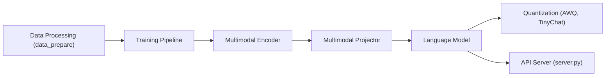

# NVlabs/VILA

> Family of NVILA vision-language models, optimized to understand videos and multiple images on GPUs and on-device.

## The problem
Understanding a video or several images with a multimodal model is expensive in compute and memory, especially outside the datacenter.

## What it actually does
The repository provides the three-stage training code (alignment, pre-training on MMC4 and Coyo, supervised fine-tuning), the `vila-eval` and `vila-infer` commands, 4-bit AWQ quantization for TinyChat (desktop GPUs, Jetson Orin) and TinyChatEngine (CPU), and an OpenAI-compatible FastAPI API server. The published checkpoints are NVILA-8B, NVILA-15B and their Lite variants. The README gives throughput tables (tokens per second) on A100, 4090 and Orin.

## How it is wired


## Trying it
```bash
./environment_setup.sh vila
conda activate vila
vila-infer --model-path Efficient-Large-Model/NVILA-15B --conv-mode auto --text "Please describe the image" --media demo_images/demo_img.png
python -W ignore server.py --port 8000 --model-path Efficient-Large-Model/NVILA-15B --conv-mode auto
```

## Cost and gotchas
The README plans training steps on an 8×A100 node. The API server is for evaluation only, with no production optimization; SGLang is announced "soon". Installation assumes Anaconda; an optional step involves an internal NVIDIA repository. The license of the weights is not documented in the README.

## What it is not
Not a simple package to install with pip: it is a research repository with training and environment scripts. The README mixes VILA, NVILA, LongVILA and VILA-HD. The throughputs are NVIDIA's, measured at batch 1 with TinyChat.

## Alternatives
No alternative cited in the README.

## For you
Worth watching: interesting for video understanding on GPU or Jetson with quantization, but research-grade, heavy to train, and the weights license remains to be checked before any use.
