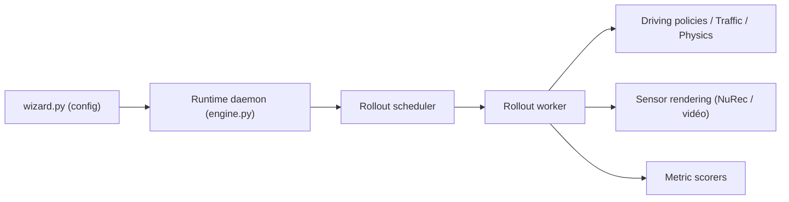

# NVlabs/alpasim

> Modular research simulator for autonomous driving, which tests driving policies in closed loop.

## The problem
Validating a driving policy end to end requires simulating sensors, vehicle dynamics and traffic, which static datasets cannot provide.

## What it actually does
A runtime orchestrates closed-loop rollouts (scheduler, workers, event loop) and calls interchangeable gRPC services: driving policy, traffic, vehicle physics, controller and sensor rendering (NuRec by default, OmniDreams via FlashDreams). Scorers evaluate and aggregate the results; ASL logs can be replayed. Supported policies: Alpamayo-R1, Alpamayo 1.5, VaVAM, Transfuser (provisional).

## How it is wired

## Trying it
The README contains no command: it points to the Tutorial (Docker Compose, single machine) and to `src/tools/run-on-slurm` for a cluster.

## Cost and gotchas
Docker and a GPU for rendering and policies. The NuRec datasets come from Hugging Face and the sample artifacts from Git LFS. No quantified hardware requirement in the README.

## What it is not
Not a certification-ready simulator: it is a research bench, with policies marked "provisional". Outside autonomous driving, it has no use.

## Alternatives
No named alternative in the README.

## For you
Watch: an architecture reference for simulation built on gRPC microservices, useful only if you work on autonomous driving or policy evaluation.
