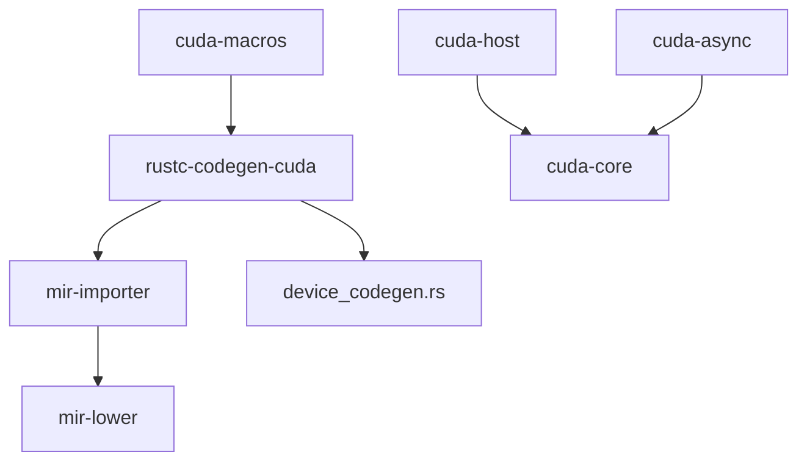

# NVlabs/cuda-oxide

> NVIDIA's CUDA platform for Rust: write GPU kernels in Rust, in thread-by-thread or tile style.

## The problem
CUDA kernels are written in C++, without Rust's memory guarantees.

## What it actually does
Two models: cuda-oxide (SIMT, a `rustc` backend that compiles Rust to PTX, drivable with `cargo oxide`) and cutile-rs (tile model, just-in-time compilation). A common runtime provides driver bindings, contexts, streams, buffers and composable asynchronous operations. Rust's ownership rules are extended to the GPU launch boundary.

## How it is wired


## Trying it
```bash
# Aucune commande complète dans le README : il renvoie aux livres cuda-oxide et cutile-rs.
```

## Cost and gotchas
Free, but an NVIDIA GPU is required. The README describes an early research project: bugs, incomplete features, API breakage. The toolchain is pinned (Rust 1.99.1 for the SIMT model) and goes through LLVM and Clang.

## What it is not
Not a ready-to-use compute library like PyTorch: it is a way to write your own kernels. No performance gain is measured in the README.

## Alternatives
No alternative named in the README.

## For you
Watch: interesting for following NVIDIA's Rust GPU kernels, too young for production use.
