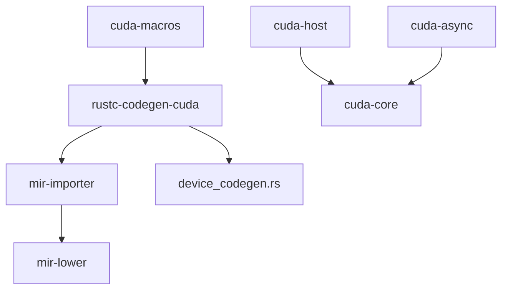

# NVlabs/cuda-oxide

> Plateforme CUDA pour Rust de NVIDIA : écrire des noyaux GPU en Rust, au style fil par fil ou par tuiles.

## Le problème
Écrire des noyaux CUDA se fait en C++ sans les garanties mémoire de Rust.

## Ce que ça fait vraiment
Deux modèles : cuda-oxide (SIMT, un backend `rustc` qui compile Rust vers PTX, pilotable par `cargo oxide`) et cutile-rs (modèle à tuiles, compilation à la volée). Un runtime commun fournit liaisons du pilote, contextes, flux, tampons et opérations asynchrones composables. Les règles de possession de Rust sont étendues à la frontière du lancement GPU.

## Comment c'est branché


## Essayer
```bash
# Aucune commande complète dans le README : il renvoie aux livres cuda-oxide et cutile-rs.
```

## Coût et pièges
Gratuit, mais un GPU NVIDIA est nécessaire. Le README parle d'un projet de recherche précoce : bogues, fonctions incomplètes, ruptures d'API. La chaîne d'outils est épinglée (Rust 1.99.1 pour le modèle SIMT) et passe par LLVM et Clang.

## Ce que ce n'est pas
Ce n'est pas une bibliothèque de calcul prête à l'emploi comme PyTorch : c'est un moyen d'écrire ses propres noyaux. Aucun gain de performance n'est mesuré dans le README.

## Alternatives
Aucune alternative nommée dans le README.

## Pour toi
À surveiller : intéressant pour suivre le noyau GPU en Rust côté NVIDIA, trop jeune pour un usage en production.

