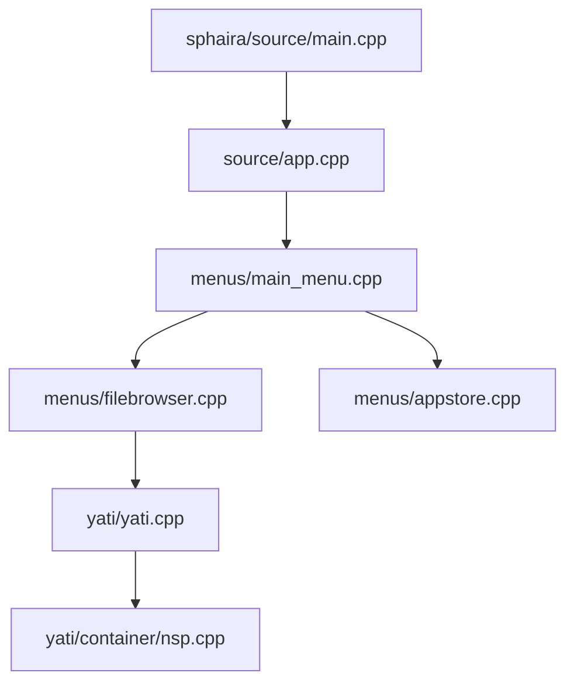

# NaGaa95/sphaira

> Homebrew menu for the Nintendo Switch with file browser, FTP, MTP and package installation.

## The problem
On a modded Switch, the standard homebrew menu is limited for browsing files, transferring and installing applications.

## What it actually does
Adds a menu with a file browser, FTP and MTP server, file associations to `.nro` applications and a store. Installs nsp, xci, nsz, xcz containers from SD card, USB, FTP or an Ownfoil server. Handles USB drives (FAT, exFAT, NTFS).

## How it is wired
Diagram based on the code diagram.


## Trying it
```bash
git clone https://github.com/ITotalJustice/sphaira.git
cd sphaira
cmake --preset MinSizeRel
cmake --build --preset MinSizeRel
```

## Cost and gotchas
Free. Requires devkitPro and its packages (or Docker via `tools/nro-builder/build.sh`), plus a Switch console with modified firmware.

## What it is not
Neither a general-purpose tool nor PC software. Its installation features concern modded Nintendo hardware.

## Alternatives
No alternative named in the README (ns-usbloader and fluffy are cited as USB-compatible tools, not as alternatives).

## For you
Ignore: specific to the Switch console, no use for data / AI / MLOps work.
