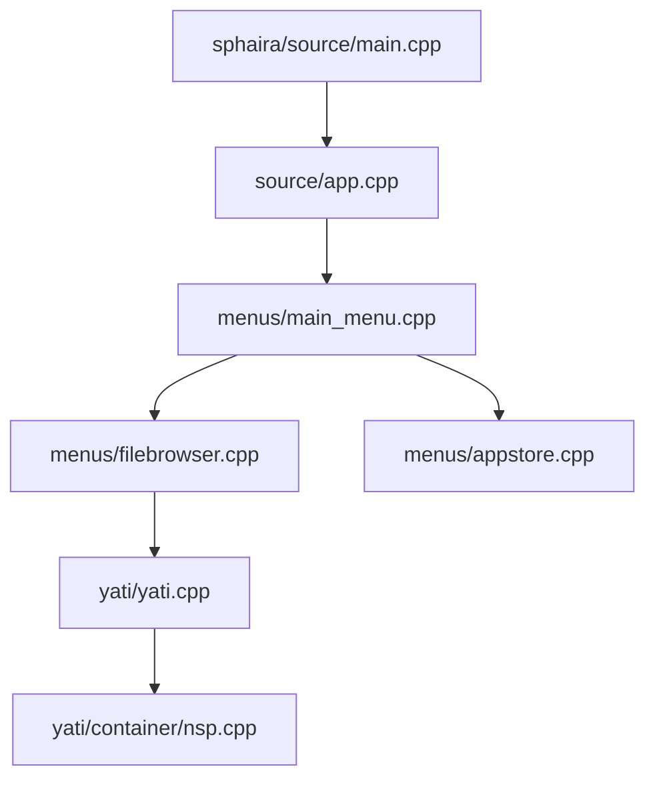

# NaGaa95/sphaira

> Menu homebrew pour Nintendo Switch avec navigateur de fichiers, FTP, MTP et installation de paquets.

## Le problème
Sur une Switch modifiée, le menu homebrew standard est limité pour parcourir les fichiers, transférer et installer des applications.

## Ce que ça fait vraiment
Ajoute un menu avec navigateur de fichiers, serveur FTP et MTP, associations de fichiers vers des applications `.nro` et un magasin. Installe des conteneurs nsp, xci, nsz, xcz depuis carte SD, USB, FTP ou un serveur Ownfoil. Gère les disques USB (FAT, exFAT, NTFS).

## Comment c'est branché
Schéma d'après le diagramme du code.


## Essayer
```bash
git clone https://github.com/ITotalJustice/sphaira.git
cd sphaira
cmake --preset MinSizeRel
cmake --build --preset MinSizeRel
```

## Coût et pièges
Gratuit. Exige devkitPro et ses paquets (ou Docker via `tools/nro-builder/build.sh`), plus une console Switch avec firmware modifié.

## Ce que ce n'est pas
Ni outil généraliste ni logiciel pour PC. Ses fonctions d'installation concernent le matériel Nintendo modifié.

## Alternatives
Aucune alternative nommée dans le README (ns-usbloader et fluffy sont cités comme outils compatibles USB, pas comme alternatives).

## Pour toi
À ignorer : spécifique à la console Switch, aucun usage pour un travail data / IA / MLOps.

