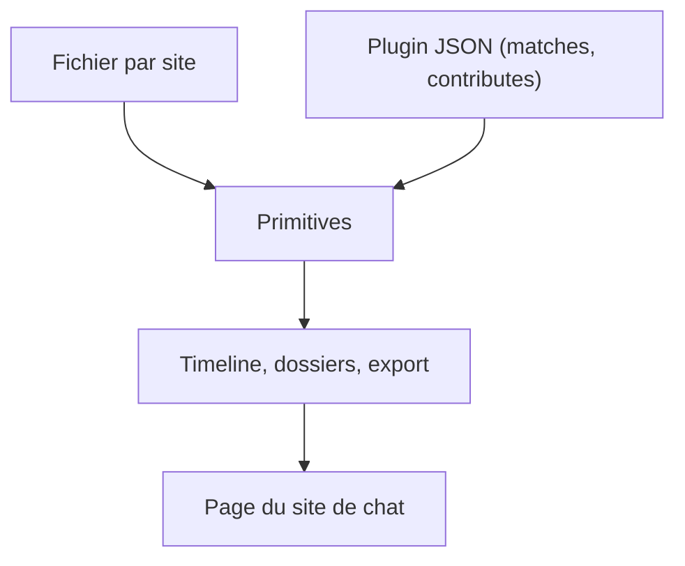

# Nagi-ovo/gemini-voyager

> Browser extension that adds folders, timeline and export to AI chat sites, including Gemini and ChatGPT.

## The problem
AI chat interfaces offer little organization: no folders, no navigation within a long conversation, limited export.

## What it actually does
Three layers: a small file per site (where the sidebar, a message, the input area are), "primitives" (timeline, folders, formula copy, diagrams, export) and plugins in pure JSON. A plugin cannot execute code or load from the network. Sites cited: Gemini, AI Studio, ChatGPT, Claude, DeepSeek, Kimi. Folder synchronization via Google Drive, or iCloud on Safari.

## How it is wired


## Trying it
```bash
bun i
bun run dev:chrome
bun run build:chrome
npx create-voyager-plugin@latest init my-plugin --site claude
```

## Cost and gotchas
Free. Built with Bun. Synchronization goes through Google Drive or iCloud, so through a third-party account. On Gemini for Enterprise, only the prompt library works. The README contains a referral link for a third-party tool.

## What it is not
Not an AI client, nor an API: it modifies the display of existing sites. A site redesign can break a site file until it is fixed. Gemini folders are still built-in code, not a plugin.

## Alternatives
- DeepSeek Voyager: fork adapted to DeepSeek.
- claude-nexus: extension for Claude.ai inspired by Voyager.
- DeepSeek Enhancer: equivalent extension for the DeepSeek web app.

## For you
Watch: useful if you spend a lot of time in AI chats and want to organize them; one-person project, recent (October 2025), therefore fragile.
