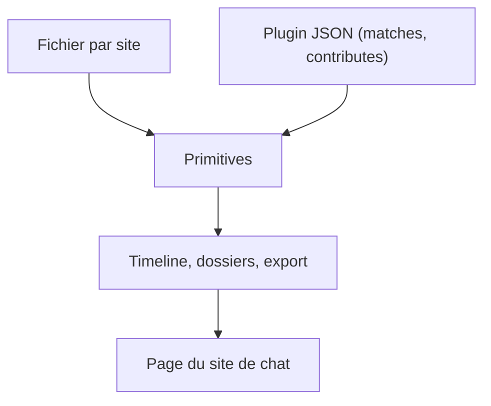

# Nagi-ovo/gemini-voyager

> Extension de navigateur qui ajoute dossiers, timeline et export aux sites de chat IA, dont Gemini et ChatGPT.

## Le problème
Les interfaces de chat IA offrent peu d'organisation : pas de dossiers, pas de navigation dans une longue conversation, un export limité.

## Ce que ça fait vraiment
Trois couches : un petit fichier par site (où est la barre latérale, un message, la zone de saisie), des « primitives » (timeline, dossiers, copie de formules, diagrammes, export) et des plugins en JSON pur. Un plugin ne peut pas exécuter de code ni charger du réseau. Sites cités : Gemini, AI Studio, ChatGPT, Claude, DeepSeek, Kimi. Synchronisation des dossiers via Google Drive, ou iCloud sur Safari.

## Comment c'est branché


## Essayer
```bash
bun i
bun run dev:chrome
bun run build:chrome
npx create-voyager-plugin@latest init my-plugin --site claude
```

## Coût et pièges
Gratuit. Compilation avec Bun. La synchronisation passe par Google Drive ou iCloud, donc par un compte tiers. Sur Gemini for Enterprise, seule la bibliothèque de prompts fonctionne. Le README contient un lien de parrainage pour un outil tiers.

## Ce que ce n'est pas
Ce n'est pas un client IA, ni une API : il retouche l'affichage de sites existants. Une refonte d'un site peut casser un fichier de site jusqu'à sa correction. Les dossiers Gemini sont encore du code intégré, pas un plugin.

## Alternatives
- DeepSeek Voyager : fork adapté à DeepSeek.
- claude-nexus : extension pour Claude.ai inspirée de Voyager.
- DeepSeek Enhancer : extension équivalente pour l'app web DeepSeek.

## Pour toi
Surveiller : utile si tu passes beaucoup de temps dans des chats IA et veux les ranger ; projet d'une seule personne, récent (octobre 2025), donc fragile.

