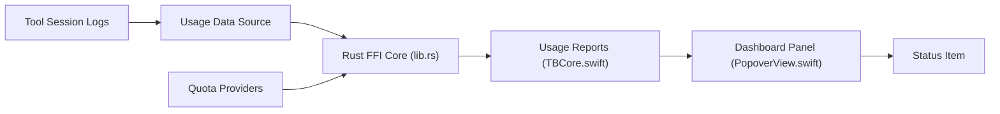

# Nanako0129/TokenBar

> Former version of the macOS token and quota tracking application, now called Syrtis.

## The problem
Same need as Syrtis: see what your AI coding agents consume, without a common dashboard.

## What it actually does
It reads the local logs of 25+ agents and displays tokens, costs and remaining quota in the menu bar, with a chat that runs faster as consumption rises. Seven views (Models, Monthly, Daily, Hourly, Stats, Agents, Settings), OAuth quota cards and a 3D graph. Rust core (`tb_core_ffi`), Swift interface.

## How it is wired


## Trying it
```bash
brew install --cask nanako0129/tokenbar/tokenbar
make
make run
swift run TokenBar --smoke
```

## Cost and gotchas
Free. Application ad hoc signed but not notarized: the cask removes the quarantine attribute at installation, as the README says. Apple Silicon Mac, macOS 14 minimum.

## What it is not
Not the maintained version: the Syrtis README states that the app was called TokenBar until 2.0. The repository seems parallel (pushed on September 17, 2026, versus the 28th for Syrtis), with no clear status in the material provided.

## Alternatives
- Syrtis (Nanako0129/syrtis): successor, signed and notarized.
- tokscale: engine from which both derive.

## For you
Ignore in favor of Syrtis: same code base, but not notarized, with quarantine disabling at installation.
