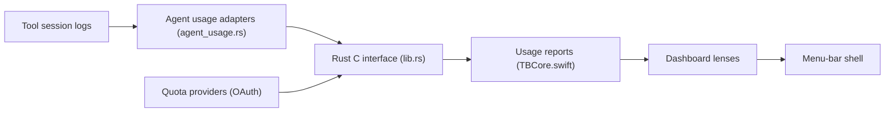

# Nanako0129/syrtis

> macOS menu-bar application that shows tokens, costs and quotas of your AI coding tools.

## The problem
AI coding tools (Claude Code, Codex, Cursor, Gemini CLI…) consume tokens and subscription quotas with no common dashboard.

## What it actually does
It reads the session logs the tools already write to disk (25+ tools), with no telemetry, no account and no cloud sync. The Rust core (`tokscale-core`, as a submodule, plus `crates/tb_core_ffi` for quotas) parses, aggregates and prices; Swift handles the views, the `NSStatusItem` and Sparkle updates. Eight views: Overview, Quota, Models, Monthly, Daily, Hourly, Stats, Agents, plus a 3D activity graph.

## How it is wired


## Trying it
```bash
brew install --cask nanako0129/tap/syrtis
make
make run
swift run Syrtis --smoke
```

## Cost and gotchas
Free. Apple Silicon Mac on macOS 14 minimum; Liquid Glass requires macOS 26 and the glass panel macOS 27; build with Xcode 27. Signed with Developer ID and notarized. Quota cards go through OAuth to the providers.

## What it is not
Not an official billing tool: costs are estimated from local logs and a third-party pricing engine. It is the current name of the former TokenBar (renamed at version 2.0). Windows: separate version on the same Rust core.

## Alternatives
- tokscale: the engine and TUI it derives from.
- CodexBar: reference for quota pace cards.
- tokcat: Tauri ancestor it originates from.

## For you
Watch: tracking your Claude Code token and quota consumption is useful in practice, provided you have a recent Mac.
