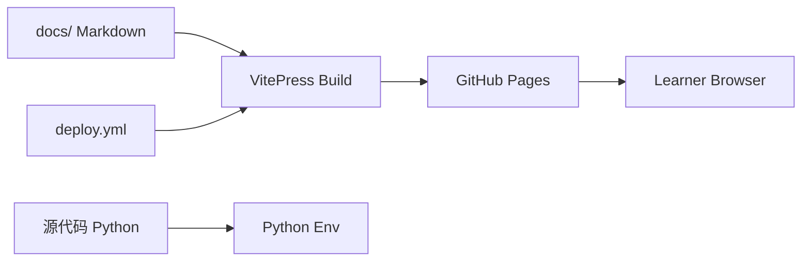

# NanmiCoder/CrawlerTutorial

> Chinese-language tutorial on web crawling, from beginner to advanced techniques, with Python code.

## The problem
Learning to collect web data in a structured way: tools, requests, storage, automated browser, authentication.

## What it actually does
A documentation site (VitePress, published via GitHub Actions) accompanied by a `源代码` folder of Python scripts per chapter. The README lists 11 introductory chapters and 11 in-depth ones (requests, proxies, Playwright, cookies, captchas, cleaning, analysis); the "advanced" part is marked "coming soon". Videos are announced.

## How it is wired


## Trying it
```bash
# Aucune commande dans le README.
# Lecture en ligne : https://nanmicoder.github.io/CrawlerTutorial/
```

## Cost and gotchas
Free. Content in Chinese. No license declared: reuse of the code and texts is not permitted by default.

## What it is not
Not an installable library. The README forbids commercial use and large-scale scraping of third-party platforms; the advanced part does not exist yet. The code was not reviewed here.

## Alternatives
- MediaCrawler: another repository by the author, cited in the README.

## For you
Worth watching: useful if you read Chinese and want a pedagogical progression; the lack of a license and the non-commercial scope limit reuse.
