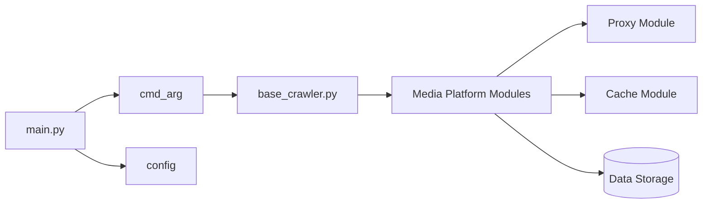

# NanmiCoder/MediaCrawler

> Playwright crawler for Chinese social platforms (Xiaohongshu, Douyin, Bilibili, Weibo, Zhihu…): posts and comments.

## The problem
Collecting public posts and comments from Chinese platforms usually means reverse-engineering their JavaScript signatures.

## What it actually does
The crawler connects to your open Chrome in CDP mode (or launches Playwright), reuses the logged-in session and retrieves the signature parameters through JS expressions, without reverse engineering.
`main.py` reads the arguments (`cmd_arg`) and the configuration (`config/base_config.py`), then delegates to one module per platform (`media_platform`) on a common base (`base_crawler.py`), with local or Redis cache and a proxy pool.
Keyword search, posts by ID, second-level comments, creator pages, media (covers, videos). Storage in CSV, JSON, Excel, SQLite or MySQL; optional WebUI.

## How it is wired


## Trying it
```bash
cd MediaCrawler
uv sync
uv run playwright install
uv run main.py --platform xhs --lt qrcode --type search
uv run main.py --help
```

## Cost and gotchas
Free, but you need an account on each platform (QR code login), Chrome 144+ or Playwright, Node.js 16+. License not identified by GitHub; the README forbids any commercial use.

## What it is not
The README reserves it for learning and disclaims all responsibility: not a large-scale collection tool. Resuming after interruption and multi-account are reserved for MediaCrawlerPro, which is paid.

## Alternatives
- MediaCrawlerPro — paid version by the same author: resume, multi-account, no Playwright.

## For you
To ignore: legal risk and platforms outside your scope.
