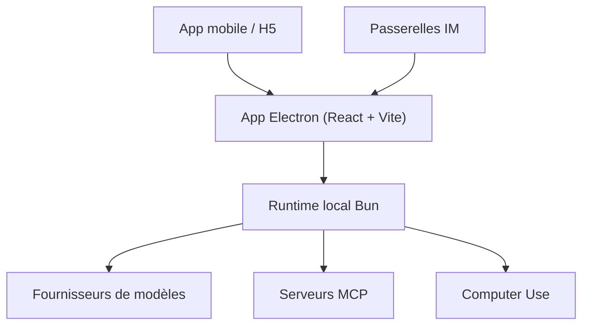

# NanmiCoder/cc-haha

> Desktop workstation for Claude Code: multiple sessions, diff review, browser, permissions and mobile.

## The problem
Using Claude Code in a terminal makes it hard to follow several sessions, review changes and approve actions.

## What it actually does
Electron application bringing together sessions, global search, worktrees, per-file diff, built-in browser, five permission modes, MCP and sub-agent management, model request tracking and Computer Use. It supports several models (Claude, ChatGPT, Grok, DeepSeek, Kimi, GLM, local ones). Mobile app, IM and scheduled tasks. README in Chinese.

## How it is wired

Diagram inferred from the README; no code diagram provided.

## Trying it
```bash
# non documenté en ligne de commande : télécharger l'installateur depuis les Releases
```

## Cost and gotchas
Provider, API key and model must be configured yourself. Installers possibly unsigned (macOS and SmartScreen warnings). Some sponsors sell API relays: handle with caution.

## What it is not
Not open source in the OSI sense: Community Source license, commercial use subject to written permission. Maintained by one person.

## Alternatives
No alternative named in the README.

## For you
Worth watching: interesting if you work a lot with Claude Code, but non-OSI license and a single-maintainer project.
