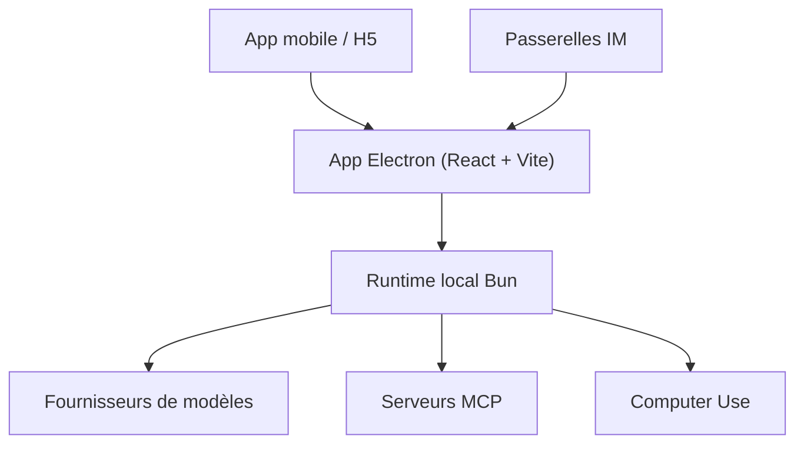

# NanmiCoder/cc-haha

> Poste de travail de bureau pour Claude Code : sessions multiples, revue de diff, navigateur, permissions et mobile.

## Le problème
Utiliser Claude Code en terminal rend difficile le suivi de plusieurs sessions, la revue des changements et l'approbation des actions.

## Ce que ça fait vraiment
Application Electron regroupant sessions, recherche globale, worktrees, diff par fichier, navigateur intégré, cinq modes de permission, gestion MCP et sous-agents, suivi des requêtes modèles et Computer Use. Elle accepte plusieurs modèles (Claude, ChatGPT, Grok, DeepSeek, Kimi, GLM, locaux). Application mobile, IM et tâches planifiées. README en chinois.

## Comment c'est branché

Schéma déduit du README, sans diagramme de code fourni.

## Essayer
```bash
# non documenté en ligne de commande : télécharger l'installateur depuis les Releases
```

## Coût et pièges
Fournisseur, clé API et modèle à configurer soi-même. Installateurs possiblement non signés (alertes macOS et SmartScreen). Des sponsors vendent des relais d'API : à manier avec prudence.

## Ce que ce n'est pas
Pas open source au sens OSI : licence Community Source, usage commercial soumis à autorisation écrite. Maintenu par une personne.

## Alternatives
Aucune alternative nommée dans le README.

## Pour toi
À surveiller : intéressant si tu travailles beaucoup avec Claude Code, mais licence non OSI et projet à mainteneur unique.

