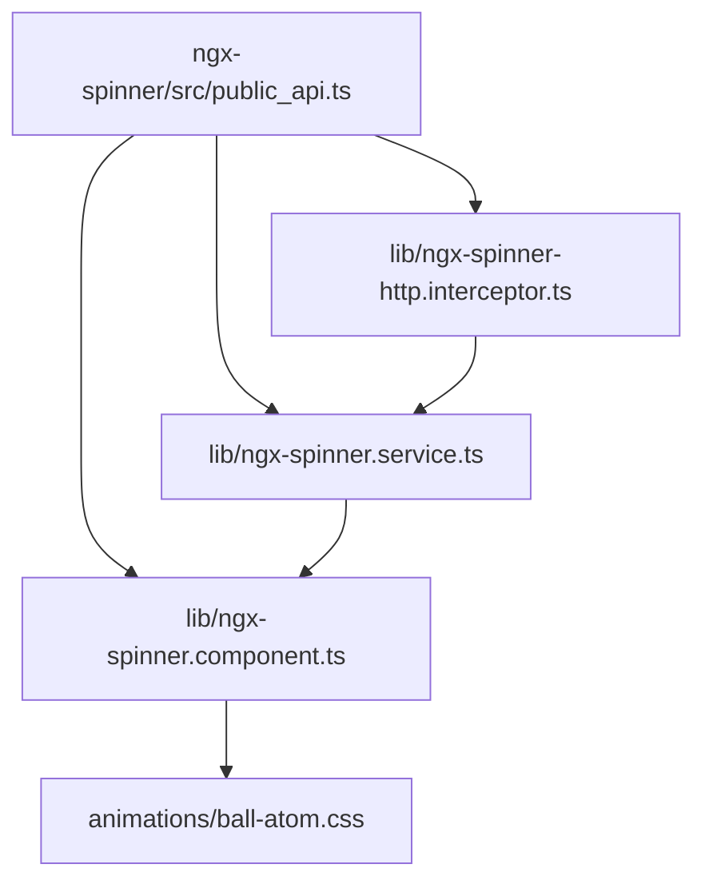

# Napster2210/ngx-spinner

> Angular library of over 50 loading indicators, driven by a service or an HTTP interceptor.

## The problem
Displaying a consistent loading indicator during network calls requires repetitive code.

## What it actually does
A `<ngx-spinner>` component and an `NgxSpinnerService` service (`show` and `hide`) display the chosen animation, with several named spinners. An optional HTTP interceptor counts in-flight requests and hides the spinner once all of them finish. Each type corresponds to an animation CSS file to add in `angular.json`.

## How it is wired
Diagram based on the code's diagram.


## Trying it
```bash
npm install ngx-spinner --save
ng add ngx-spinner
```

## Cost and gotchas
Free. You must pick the version matching your Angular version and add the CSS files of the animations you want. The `CUSTOM_ELEMENTS_SCHEMA` schema is required.

## What it is not
Not a general component library: only loading indicators, for Angular only.

## Alternatives
No alternative named in the README (the inspiration is Load Awesome).

## For you
Ignore: useful only if you are building an Angular interface, unrelated to your data / AI work.
