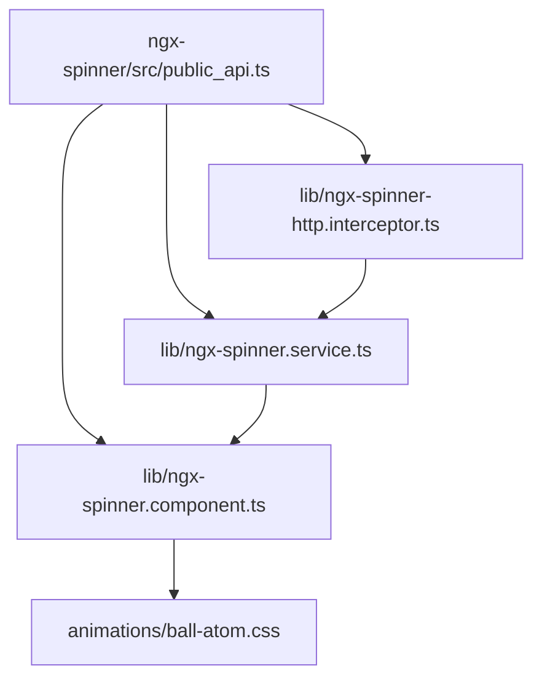

# Napster2210/ngx-spinner

> Bibliothèque Angular de plus de 50 indicateurs de chargement, pilotés par service ou intercepteur HTTP.

## Le problème
Afficher un indicateur de chargement cohérent pendant les appels réseau demande du code répétitif.

## Ce que ça fait vraiment
Un composant `<ngx-spinner>` et un service `NgxSpinnerService` (`show` et `hide`) affichent l'animation choisie, avec plusieurs spinners nommés. Un intercepteur HTTP optionnel compte les requêtes en cours et masque le spinner à la fin de toutes. Chaque type correspond à un fichier CSS d'animation à ajouter dans `angular.json`.

## Comment c'est branché
Schéma d'après le diagramme du code.


## Essayer
```bash
npm install ngx-spinner --save
ng add ngx-spinner
```

## Coût et pièges
Gratuit. Il faut choisir la version selon celle d'Angular et ajouter les fichiers CSS des animations voulues. Le schéma `CUSTOM_ELEMENTS_SCHEMA` est requis.

## Ce que ce n'est pas
Pas une bibliothèque de composants générale : seulement des indicateurs de chargement, pour Angular uniquement.

## Alternatives
Aucune alternative nommée dans le README (l'inspiration est Load Awesome).

## Pour toi
À ignorer : utile seulement si tu construis une interface Angular, sans lien avec ton métier data / IA.

