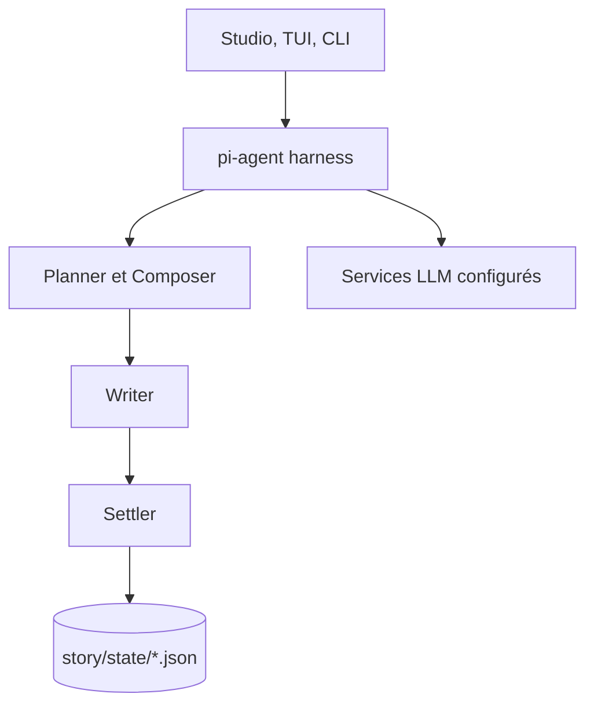

# Narcooo/inkos

> Agent system that writes, proofreads and revises novels, screenplays and interactive stories, for authors and creators.

## The problem
A single model loses the thread on a long narrative: characters, plots, continuity.

## What it actually does
A chain of agents and tools (Radar, Planner, Composer, Architect, Writer, Settler, proofreader, Reviser) around a pi-agent harness. The story state is JSON validated by Zod, with Markdown projections and SQLite FTS5 indexes. Atomic commit of chapter plus state. Web Studio, TUI, CLI, interactive Play mode, 19 `SKILL.md` skills. The README is in Chinese.

## How it is wired


## Trying it
```bash
npm i -g @actalk/inkos
inkos init my-novel
cd my-novel
inkos
inkos book create --title "吞天魔帝" --genre xuanhuan
inkos write next 吞天魔帝
```

## Cost and gotchas
API key from a model provider at your expense (kkaiapi, OpenRouter, Moonshot, etc.). Node 22.16 or later. Keys are stored in `.inkos/secrets.json`.

## What it is not
Not a data/MLOps tool. Branch 2.0 is under development, migration needed from 1.x. AGPL-3.0 license: obligations when used as a network service. The README contains partner advertisements.

## Alternatives
None named in the README (OpenClaw and ClawHub serve as an integration channel).

## For you
Keep an eye on it: interesting architecture pattern (validated state, atomic commit, skills), but editorial domain and AGPL license.
