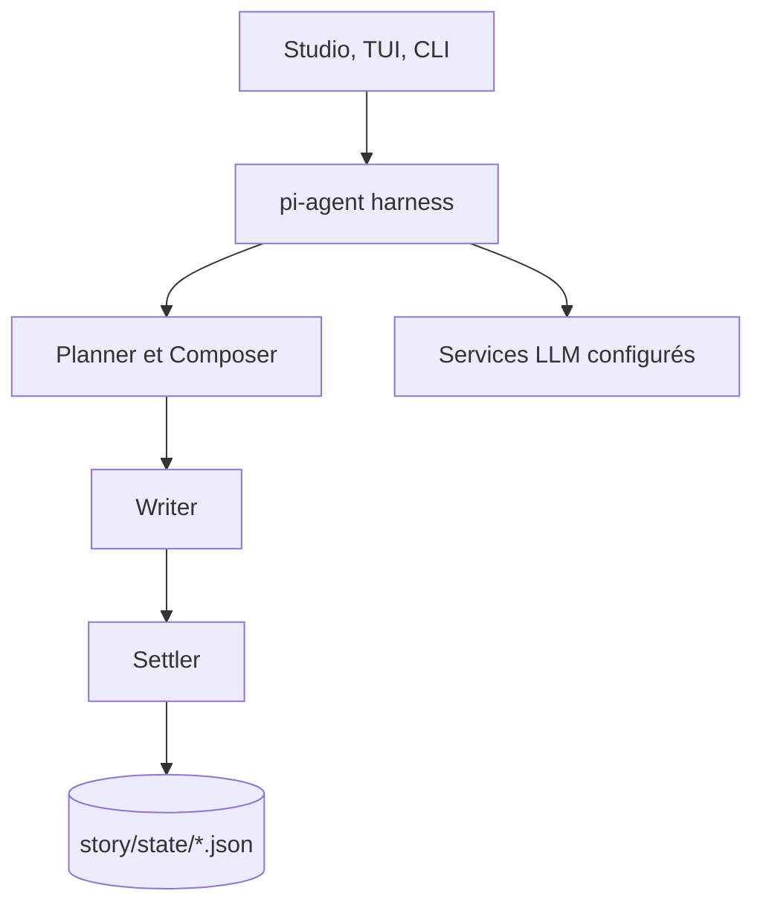

# Narcooo/inkos

> Système d'agents qui écrit, relit et révise romans, scénarios et récits interactifs, pour auteurs et créateurs.

## Le problème
Un modèle seul perd le fil sur un long récit : personnages, intrigues, continuité.

## Ce que ça fait vraiment
Chaîne agents et outils (Radar, Planner, Composer, Architect, Writer, Settler, relecteur, Reviser) autour d'un harnais pi-agent. L'état du récit est en JSON validé par Zod, avec projections Markdown et index SQLite FTS5. Commit atomique chapitre plus état. Studio web, TUI, CLI, mode Play interactif, 19 skills `SKILL.md`. Le README est en chinois.

## Comment c'est branché


## Essayer
```bash
npm i -g @actalk/inkos
inkos init my-novel
cd my-novel
inkos
inkos book create --title "吞天魔帝" --genre xuanhuan
inkos write next 吞天魔帝
```

## Coût et pièges
Clé d'API d'un fournisseur de modèles à ta charge (kkaiapi, OpenRouter, Moonshot, etc.). Node 22.16 ou plus. Les clés sont stockées dans `.inkos/secrets.json`.

## Ce que ce n'est pas
Pas un outil data/MLOps. Branche 2.0 en développement, migration à faire depuis la 1.x. Licence AGPL-3.0 : obligations en cas d'usage en service réseau. Le README contient des publicités partenaires.

## Alternatives
Aucune nommée dans le README (OpenClaw et ClawHub servent de canal d'intégration).

## Pour toi
Surveiller : motif d'architecture intéressant (état validé, commit atomique, skills), mais domaine éditorial et licence AGPL.

