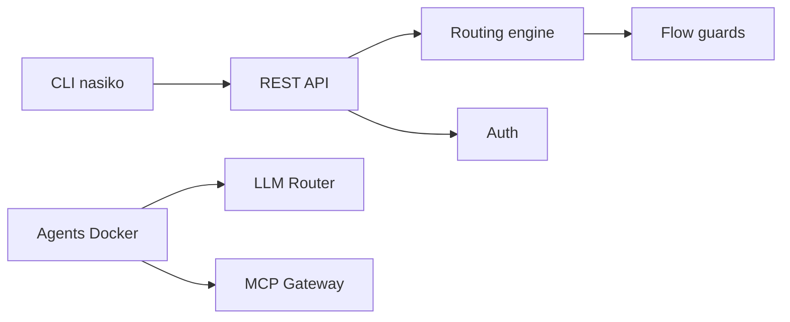

# Nasiko-Labs/nasiko

> Execution layer that discovers coding agents, attributes their costs and routes their calls to the chosen model.

## The problem
Teams run several coding agents and nobody knows who spent what, on which model.

## What it actually does
A single Rust server that receives session reports from agents (Claude Code, Codex, OpenCode, Cursor), routes the LLMs, applies guardrails (ACLs, depth and token limits), exposes an MCP gateway and a built-in OCI registry. State lives in Postgres, Redis and S3; telemetry goes through OpenTelemetry.

## How it is wired


## Trying it
```bash
git clone https://github.com/Nasiko-Labs/nasiko.git && cd nasiko
cargo install --path cli/ --force
nasiko agents discover
```

## Cost and gotchas
Rust for the CLI, Docker Compose for the server. A provider key is required (OpenAI by default) and secrets must be generated (`JWT_SECRET`, `AGENT_JWT_SECRET`). The default admin password must be changed. The router and hooks modify the agents' global configuration.

## What it is not
Not a simple read-only tool: routing touches the user's global settings files. The README provided is truncated, the end of the document could not be read. License not identified.

## Alternatives
No alternative cited in the README.

## For you
Worth watching: addresses a real need for agent cost tracking, but young, intrusive and with a license to verify.
