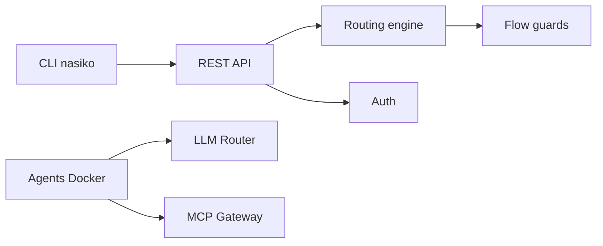

# Nasiko-Labs/nasiko

> Couche d'exécution qui découvre les agents de code, attribue leurs coûts et route leurs appels vers le modèle choisi.

## Le problème
Les équipes lancent plusieurs agents de code et personne ne sait qui a dépensé quoi, sur quel modèle.

## Ce que ça fait vraiment
Un serveur Rust unique qui reçoit les rapports de session des agents (Claude Code, Codex, OpenCode, Cursor), les routeurs LLM, applique des garde-fous (ACL, limites de profondeur et de jetons), expose une passerelle MCP et un registre OCI intégré. L'état vit dans Postgres, Redis et S3 ; la télémétrie passe par OpenTelemetry.

## Comment c'est branché


## Essayer
```bash
git clone https://github.com/Nasiko-Labs/nasiko.git && cd nasiko
cargo install --path cli/ --force
nasiko agents discover
```

## Coût et pièges
Rust pour la CLI, Docker Compose pour le serveur. Il faut une clé fournisseur (OpenAI par défaut) et des secrets à générer (`JWT_SECRET`, `AGENT_JWT_SECRET`). Le mot de passe admin par défaut est à changer. Le router et les hooks modifient la configuration globale des agents.

## Ce que ce n'est pas
Pas un simple outil de lecture : le routage touche aux fichiers de réglages globaux de l'utilisateur. Le README fourni est tronqué, la fin du document n'a pas pu être lue. Licence non identifiée.

## Alternatives
Aucune alternative citée dans le README.

## Pour toi
À surveiller : répond à un vrai besoin de suivi des coûts d'agents, mais jeune, intrusif et de licence à vérifier.

