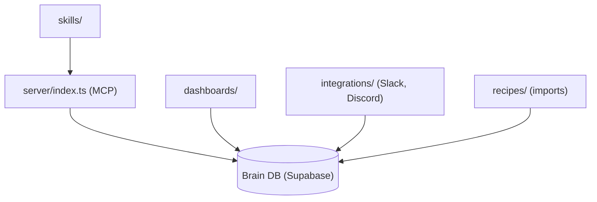

# NateBJones-Projects/OB1

> Shared memory on Postgres with vector search and MCP, which all your AI tools read and write.

## The problem
Each AI assistant (Claude, ChatGPT, Cursor) keeps its own memory of you, with no sharing between them.

## What it actually does
A repository of modules around a Supabase/Postgres database where "thoughts" are stored with embeddings. It provides an MCP server, dashboards (Next.js, SvelteKit), Slack and Discord captures, import recipes (ChatGPT, Obsidian, Gmail, X), agent skills and extensions of the workflow (household, CRM, job search). Contributions come from the community.

## How it is wired


## Trying it
```bash
# Aucune commande shell dans le README : suivre le Setup Guide (environ 45 minutes)
# ou l'installation assistée par Cursor ou Claude Code.
```

## Cost and gotchas
Supabase, an AI gateway and a Slack channel are required, with their quotas and possible bills. Embedding and LLM calls are at your expense. The license is not identified by GitHub.

## What it is not
It is not a single application nor a simple notebook: it is an assembly of modules written by various contributors, of uneven quality.

## Alternatives
No alternative named in the README.

## For you
Worth watching: the idea of a shared AI memory via MCP speaks to an AI profile, but the setup depends on third-party SaaS and an unclear license.
