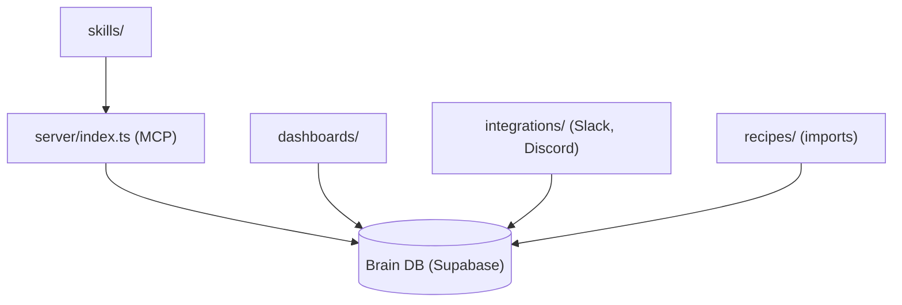

# NateBJones-Projects/OB1

> Mémoire partagée sur Postgres avec recherche vectorielle et MCP, que tous tes outils IA lisent et écrivent.

## Le problème
Chaque assistant IA (Claude, ChatGPT, Cursor) garde sa propre mémoire de toi, sans partage entre eux.

## Ce que ça fait vraiment
Dépôt de modules autour d'une base Supabase/Postgres où des « pensées » sont stockées avec embeddings. Il fournit un serveur MCP, des tableaux de bord (Next.js, SvelteKit), des captures Slack et Discord, des recettes d'import (ChatGPT, Obsidian, Gmail, X), des skills d'agent et des extensions du parcours (foyer, CRM, recherche d'emploi). Les contributions viennent de la communauté.

## Comment c'est branché


## Essayer
```bash
# Aucune commande shell dans le README : suivre le Setup Guide (environ 45 minutes)
# ou l'installation assistée par Cursor ou Claude Code.
```

## Coût et pièges
Supabase, une passerelle IA et un canal Slack sont nécessaires, avec leurs quotas et leur facture éventuelle. Les appels d'embeddings et de LLM sont à ta charge. La licence n'est pas identifiée par GitHub.

## Ce que ce n'est pas
Ce n'est pas une application unique ni un simple carnet de notes : c'est un assemblage de modules écrits par des contributeurs variés, de qualité hétérogène.

## Alternatives
Aucune alternative nommée dans le README.

## Pour toi
À surveiller : l'idée d'une mémoire IA partagée via MCP parle à un profil IA, mais le montage dépend de SaaS tiers et d'une licence floue.

