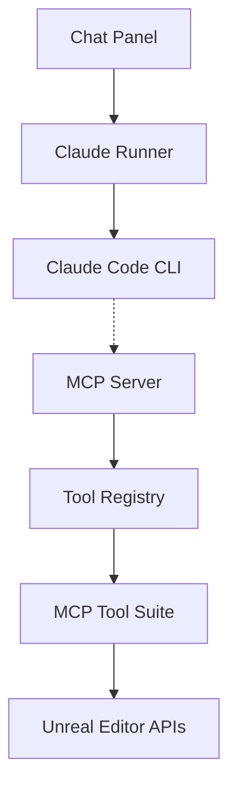

# Natfii/UnrealClaude

> Unreal Engine 5.7 plugin that embeds the Claude Code CLI in the editor and serves an MCP bridge.

## The problem
An Unreal developer constantly switches windows between the editor and their coding assistant, which cannot see the project.

## What it actually does
Adds a chat panel in the editor that runs `claude -p` in the project folder. An MCP server (port 3000, more than 20 tools) lets you manipulate actors, Blueprints, levels, materials and assets. Scripts go through a permission dialog that is denied by default. Sessions are saved locally.

## How it is wired


## Trying it
```bash
npm install -g @anthropic-ai/claude-code
claude auth login
git clone --recurse-submodules https://github.com/Natfii/UnrealClaude.git
cd <PluginPath>/UnrealClaude/Resources/mcp-bridge
npm install
```

## Cost and gotchas
An Anthropic account (subscription or API) and building the plugin by hand, with no binary. The `--skip-permissions` mode gives Claude the Bash, Write and Edit tools on your project.

## What it is not
It cannot be used outside Unreal 5.7. The Blueprint tools still have bugs, according to the README. No license is declared.

## Alternatives
No alternative named in the README.

## For you
Keep an eye on it: the missing license rules out any safe reuse, and the value only concerns Unreal developers.
