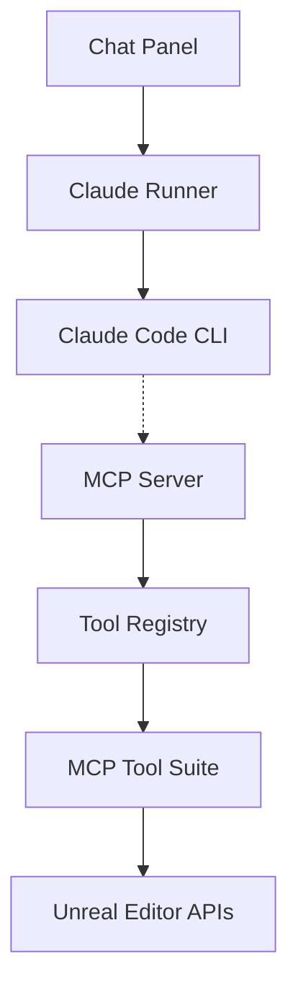

# Natfii/UnrealClaude

> Plugin Unreal Engine 5.7 qui intègre la CLI Claude Code dans l'éditeur et sert un pont MCP.

## Le problème
Un développeur Unreal change sans cesse de fenêtre entre l'éditeur et son assistant de code, qui ne voit pas le projet.

## Ce que ça fait vraiment
Ajoute un panneau de chat dans l'éditeur qui lance `claude -p` dans le dossier du projet. Un serveur MCP (port 3000, plus de 20 outils) permet de manipuler acteurs, Blueprints, niveaux, matériaux et assets. Les scripts passent par une boîte de permission refusée par défaut. Les sessions sont sauvegardées localement.

## Comment c'est branché


## Essayer
```bash
npm install -g @anthropic-ai/claude-code
claude auth login
git clone --recurse-submodules https://github.com/Natfii/UnrealClaude.git
cd <PluginPath>/UnrealClaude/Resources/mcp-bridge
npm install
```

## Coût et pièges
Compte Anthropic (abonnement ou API) et compilation du plugin à la main, sans binaire. Le mode `--skip-permissions` donne à Claude les outils Bash, Write et Edit sur ton projet.

## Ce que ce n'est pas
Ce n'est pas utilisable hors Unreal 5.7. Les outils Blueprint ont encore des bogues, d'après le README. Aucune licence n'est déclarée.

## Alternatives
Aucune alternative nommée dans le README.

## Pour toi
À surveiller : la licence absente interdit tout réemploi sûr, et la valeur ne concerne que les développeurs Unreal.

