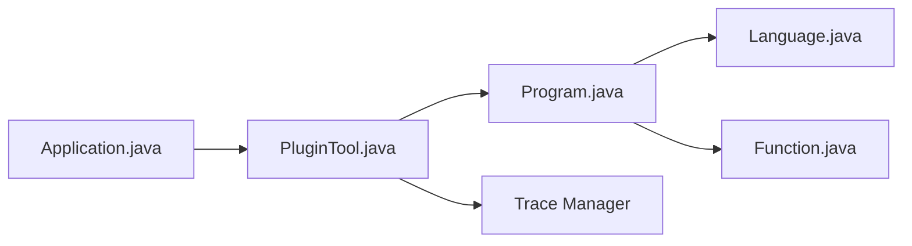

# NationalSecurityAgency/ghidra

> The NSA's software reverse-engineering framework: disassembly, decompilation and scripting.

## The problem
Analyzing compiled code, including malware, requires a disassembler, a decompiler and teamwork.

## What it actually does
Loads binaries, disassembles them, decompiles them, draws graphs and runs scripts in Java or Python (PyGhidra). Supports many instruction sets and formats. It also offers function identification, similarity search (BSim) and a debugger with traces. Prerequisite: JDK 25. The README warns of known vulnerabilities in some versions.

## How it is wired


## Trying it
```bash
./ghidraRun
./support/pyghidraRun
gradle -I gradle/support/fetchDependencies.gradle
gradle buildGhidra
```

## Cost and gotchas
Free. JDK 25 is mandatory; building requires Gradle, Python 3.9 to 3.15 and a C compiler. Read the security advisories before use.

## What it is not
Not a data or AI tool. Not to be run without precautions on dangerous samples.

## Alternatives
No alternative named in the README.

## For you
Ignore for data or MLOps work; useful only to inspect a suspicious binary or an opaque dependency.
