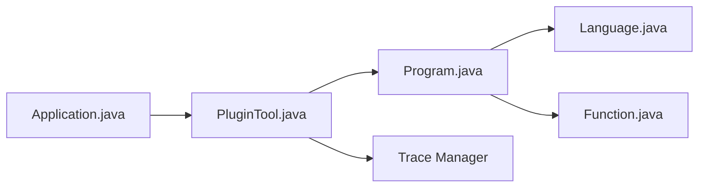

# NationalSecurityAgency/ghidra

> Cadre de rétro-ingénierie logicielle de la NSA : désassemblage, décompilation et scripts.

## Le problème
Analyser du code compilé, dont des programmes malveillants, exige désassembleur, décompilateur et travail d'équipe.

## Ce que ça fait vraiment
Charge des binaires, les désassemble, décompile, trace des graphes et exécute des scripts en Java ou Python (PyGhidra). Supporte de nombreux jeux d'instructions et formats. Il offre aussi identification de fonctions, recherche de similarité (BSim) et un débogueur avec traces. Prérequis : JDK 25. Le README avertit de vulnérabilités connues dans certaines versions.

## Comment c'est branché


## Essayer
```bash
./ghidraRun
./support/pyghidraRun
gradle -I gradle/support/fetchDependencies.gradle
gradle buildGhidra
```

## Coût et pièges
Gratuit. JDK 25 obligatoire ; la compilation demande Gradle, Python 3.9 à 3.15 et un compilateur C. Lire les avis de sécurité avant usage.

## Ce que ce n'est pas
Pas un outil de données ou d'IA. Pas à exécuter sans précaution sur des échantillons dangereux.

## Alternatives
Aucune alternative nommée dans le README.

## Pour toi
À ignorer pour du travail data ou MLOps ; utile seulement pour inspecter un binaire suspect ou une dépendance opaque.

