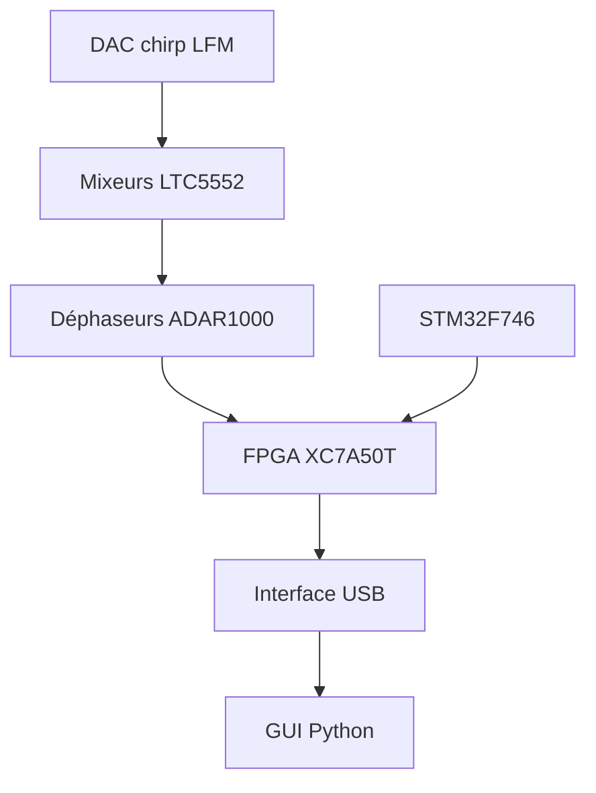

# NawfalMotii79/PLFM_RADAR

> 10.5 GHz LFM-modulated phased-array radar, open hardware and software, for researchers and radio makers.

## The problem
Electronically scanned radars are expensive and closed, which blocks experimentation in research and among advanced hobbyists.

## What it actually does
Two variants: AERIS-10N (3 km, 8x16 patch antenna) and AERIS-10X (20 km, 32x16 slotted waveguide). An XC7A50T FPGA does pulse compression, Doppler FFT, MTI and CFAR. An STM32 microcontroller handles power, phase shifters, GPS and IMU. A Python interface displays targets on a map. Schematics, boards, firmware and software are provided.

## How it is wired
Simplified diagram based on the sheet, no diagram provided.

## Trying it
No command documented in the README. The board production files are in `/4_Schematics and Boards Layout/4_7_Production Files`.

## Cost and gotchas
The code is free, but building it requires PCBs, components (including 10 W GaN amplifiers for the long-range variant), assembly and an antenna. You also need Python 3.8+ and Vivado to modify the FPGA. High-power RF emission may be subject to regulation: not documented here.

## What it is not
It is not software alone: without the hardware, there is nothing to run. There is no standalone assembly guide (the README says so). Mixed license: CERN-OHL-P for the hardware, MIT for the software; GitHub does not identify it.

## Alternatives
No alternative named in the README.

## For you
Ignore: an RF electronics project for makers, unrelated to data, AI or MLOps, even if the signal processing might interest a curious mind.
