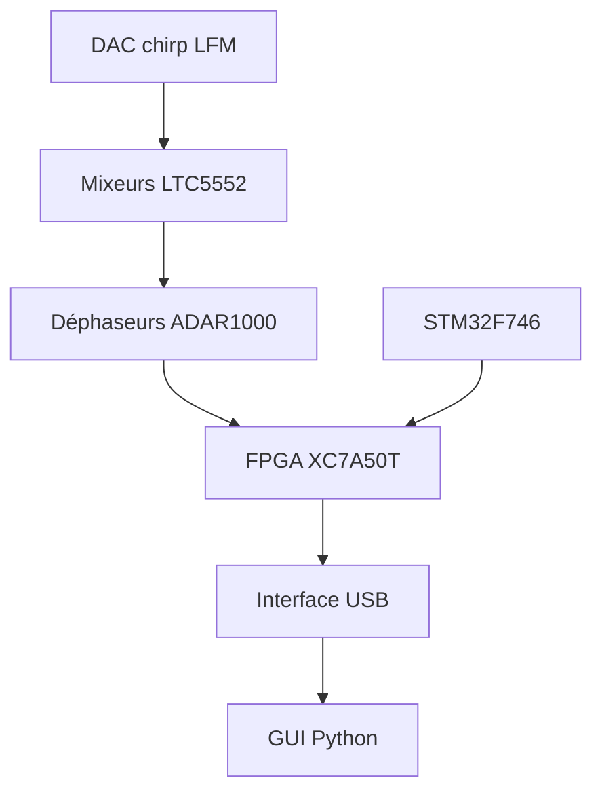

# NawfalMotii79/PLFM_RADAR

> Radar à réseau phasé 10,5 GHz à modulation LFM, matériel et logiciels ouverts, pour chercheurs et makers en radio.

## Le problème
Les radars à balayage électronique sont chers et fermés, ce qui bloque l'expérimentation en recherche et chez les amateurs avancés.

## Ce que ça fait vraiment
Deux variantes : AERIS-10N (3 km, antenne patch 8x16) et AERIS-10X (20 km, guide d'onde fendu 32x16). Un FPGA XC7A50T fait la compression d'impulsion, la FFT Doppler, le MTI et le CFAR. Un microcontrôleur STM32 gère l'alimentation, les déphaseurs, le GPS et l'IMU. Une interface Python affiche les cibles sur une carte. Schémas, cartes, firmware et logiciels sont fournis.

## Comment c'est branché
Schéma simplifié d'après la fiche, sans diagramme fourni.

## Essayer
Aucune commande documentée dans le README. Les fichiers de production des cartes sont dans `/4_Schematics and Boards Layout/4_7_Production Files`.

## Coût et pièges
Le code est libre, mais le montage exige PCB, composants (dont des amplificateurs GaN 10 W pour la variante longue portée), assemblage et antenne. Il faut aussi Python 3.8+ et Vivado pour modifier le FPGA. L'émission RF à haute puissance peut imposer une réglementation : non documenté ici.

## Ce que ce n'est pas
Ce n'est pas un logiciel seul : sans le matériel, il n'y a rien à exécuter. Il n'y a pas de guide d'assemblage autonome (le README le dit). Licence mixte : CERN-OHL-P pour le matériel, MIT pour le logiciel ; GitHub ne l'identifie pas.

## Alternatives
Aucune alternative nommée dans le README.

## Pour toi
À ignorer : projet d'électronique RF pour makers, sans rapport avec la data, l'IA ou le MLOps, même si le traitement du signal pourrait intéresser un curieux.

