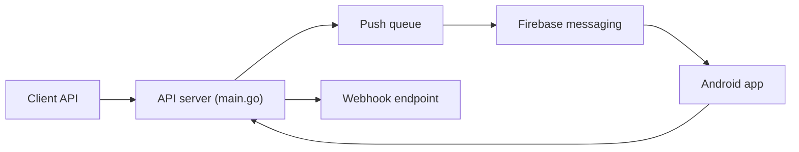

# NdoleStudio/httpsms

> SMS gateway: an HTTP API that makes an Android phone send and receive SMS.

## The problem
Buying virtual numbers is not possible in every country; the author wanted a simple way to send and receive SMS through an API.

## What it actually does
The Go API (Fiber, CockroachDB) stores the message and queues a push notification; the Android app receives the notification, fetches the message, sends it through Android's SMS API and reports back the result and delivery receipt. Webhooks for incoming SMS, end-to-end AES-256 encryption, rate limiting, message expiry. Nuxt/Vuetify interface.

## How it is wired


## Trying it
```bash
git clone https://github.com/NdoleStudio/httpsms.git
cp web/.env.docker web/.env
cp api/.env.docker api/.env
docker compose up --build
```

## Cost and gotchas
Self-hosting: Firebase account (push and authentication), SMTP, Cloudflare Turnstile, manual creation of a system user in the database, building the Android app. Pricing of the hosted service is not documented (the graph mentions a billing component). AGPL-3.0 license.

## What it is not
Not a virtual number provider: the SMS leave from your phone and your mobile plan.

## Alternatives
No alternative named in the README.

## For you
Worth watching: useful for SMS alerts from pipelines without going through a provider, but the setup is heavy and the dependency on Firebase is strong.
