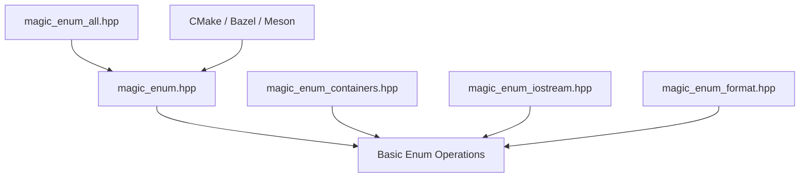

# Neargye/magic_enum

> Header-only C++17 library that reads enum names and values without macros.

## The problem
In C++, going from an enum to its name, or from a string to the enum, forces you to write tables and macros by hand.

## What it actually does
It provides the functions `enum_name`, `enum_cast`, `enum_values`, `enum_count`, `enum_switch`, as well as flag, stream and format operators. All of it is evaluated at compile time. It adds enum-indexed containers (`array`, `bitset`, `set`).

## How it is wired


## Trying it
```bash
cmake -S . -B build -G Ninja -DMAGIC_ENUM_USE_MODULES=ON
cmake --build build
```
```cpp
#include <magic_enum/magic_enum.hpp>
enum class Color { RED = -10, BLUE = 0, GREEN = 10 };
magic_enum::enum_name(Color::RED); // "RED"
```

## Cost and gotchas
Free, no dependencies. A recent compiler is required (GCC 9, Clang 9, MSVC 19.20). Enums with large values exceed the default reflection range.

## What it is not
It is not a Python tool or a data tool: it is a low-level C++ building block. It does not reflect classes, only enums.

## Alternatives
- Native C++26 reflection: automatically chosen by the library when available.

## For you
Watch: useful only if you write C++ (inference engine, native extension), otherwise irrelevant for a data / AI / MLOps profile.
