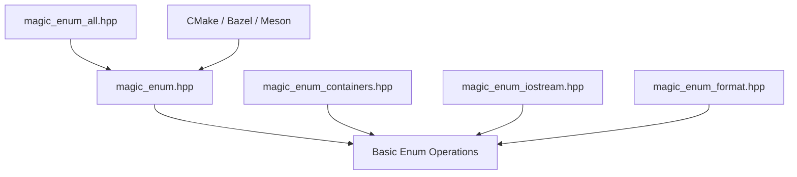

# Neargye/magic_enum

> Bibliothèque C++17 en en-têtes seuls qui lit les noms et valeurs des enums sans macro.

## Le problème
En C++, passer d'un enum à son nom, ou d'une chaîne à l'enum, oblige à écrire des tables et des macros à la main.

## Ce que ça fait vraiment
Elle fournit des fonctions `enum_name`, `enum_cast`, `enum_values`, `enum_count`, `enum_switch`, ainsi que des opérateurs de flags, de flux et de format. Le tout est évalué à la compilation. Elle ajoute des conteneurs indexés par enum (`array`, `bitset`, `set`).

## Comment c'est branché


## Essayer
```bash
cmake -S . -B build -G Ninja -DMAGIC_ENUM_USE_MODULES=ON
cmake --build build
```
```cpp
#include <magic_enum/magic_enum.hpp>
enum class Color { RED = -10, BLUE = 0, GREEN = 10 };
magic_enum::enum_name(Color::RED); // "RED"
```

## Coût et pièges
Gratuit, aucune dépendance. Il faut un compilateur récent (GCC 9, Clang 9, MSVC 19.20). Les enums à grandes valeurs dépassent la plage de réflexion par défaut.

## Ce que ce n'est pas
Ce n'est pas un outil Python ni un outil de données : c'est une brique C++ de bas niveau. Elle ne reflète pas les classes, seulement les enums.

## Alternatives
- La réflexion C++26 native : choisie automatiquement par la bibliothèque quand elle est disponible.

## Pour toi
À surveiller : utile seulement si tu écris du C++ (moteur d'inférence, extension native), sinon sans objet pour un profil data / IA / MLOps.

