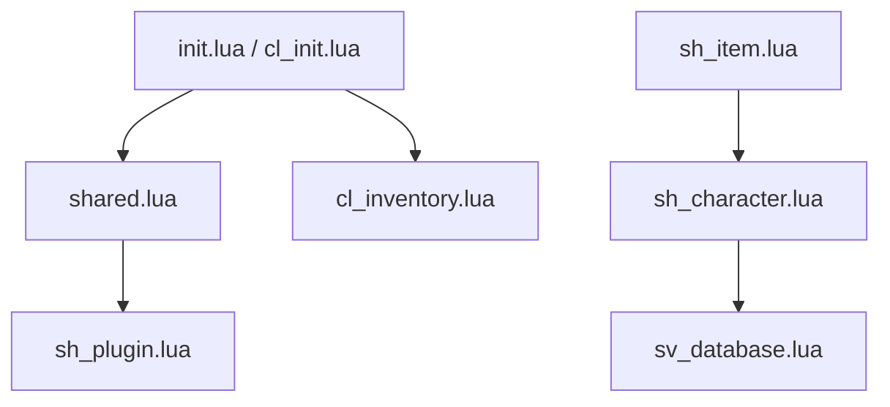

# NebulousCloud/helix

> Role-play gamemode framework for Garry's Mod, derived from NutScript 1.1.

## The problem
Creating an RP gamemode on Garry's Mod requires rewriting characters, items and inventory.

## What it actually does
Provides a Lua base: plugin libraries, characters, items and database, a Derma inventory interface. A "skeleton" schema and an HL2 RP schema serve as starting points.

## How it is wired


## Trying it
```bash
git clone https://github.com/impulsh/ldoc
cd ldoc
luarocks make
ldoc .
```

## Cost and gotchas
Free. Garry's Mod required; these commands only build the documentation.

## What it is not
Not a complete game: a foundation to build on.

## Alternatives
No alternative named in the README.

## For you
Ignore: a game framework unrelated to data/AI.
