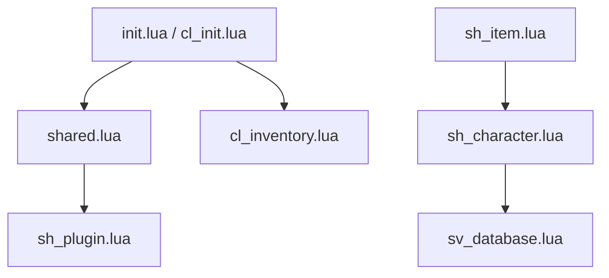

# NebulousCloud/helix

> Framework de modes de jeu de rôle pour Garry's Mod, dérivé de NutScript 1.1.

## Le problème
Créer un mode de jeu RP sur Garry's Mod demande de réécrire personnages, objets et inventaire.

## Ce que ça fait vraiment
Fournit une base Lua : bibliothèques de plugins, personnages, objets et base de données, interface d'inventaire Derma. Un schéma « skeleton » et un schéma HL2 RP servent de départ.

## Comment c'est branché


## Essayer
```bash
git clone https://github.com/impulsh/ldoc
cd ldoc
luarocks make
ldoc .
```

## Coût et pièges
Gratuit. Garry's Mod requis ; ces commandes ne servent qu'à construire la documentation.

## Ce que ce n'est pas
Pas un jeu complet : un socle à compléter.

## Alternatives
Aucune alternative nommée dans le README.

## Pour toi
À ignorer : framework de jeu sans rapport avec data/IA.

