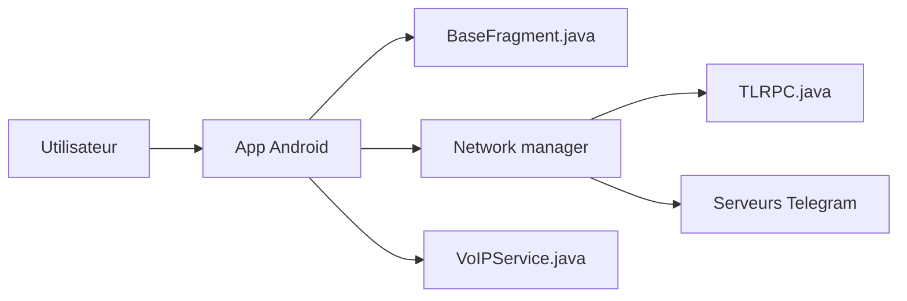

# Nekogram/Nekogram

> Unofficial Android Telegram client, a fork of Telegram with a few useful modifications.

## The problem
The official Telegram client does not offer certain customization options.

## What it actually does
Takes Telegram's Android code and adds in-house features. Based on the architecture: screens and navigation, MTProto network layer, TL models, voice and group calls, themes, web search, Stars, wallet. The README describes almost no features: it points to the website for details.

## How it is wired


## Trying it
```bash
git clone --recursive --shallow-submodules https://github.com/Nekogram/Nekogram.git
```
Downloads are at https://nekogram.app/download.

## Cost and gotchas
Free. Building it yourself requires a keystore, two Firebase apps with `google-services.json` and values in `Extra.java`. A third-party client handles your Telegram messages.

## What it is not
Not an official client and not easy to audit: a very large inherited codebase. No security guarantee beyond the README.

## Alternatives
No alternative named in the README.

## For you
Ignore: a messaging client unrelated to data/AI, with a trust risk.
