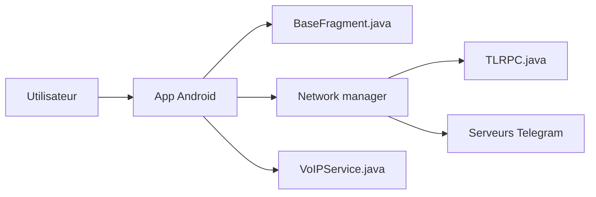

# Nekogram/Nekogram

> Client Telegram Android non officiel, fork de Telegram avec quelques modifications utiles.

## Le problème
Le client officiel Telegram n'offre pas certaines options de personnalisation.

## Ce que ça fait vraiment
Reprend le code Android de Telegram et ajoute des fonctions maison. D'après l'architecture : écrans et navigation, couche réseau MTProto, modèles TL, appels vocaux et de groupe, thèmes, recherche web, Stars, portefeuille. Le README ne décrit presque aucune fonction : il renvoie au site pour les détails.

## Comment c'est branché


## Essayer
```bash
git clone --recursive --shallow-submodules https://github.com/Nekogram/Nekogram.git
```
Les téléchargements sont sur https://nekogram.app/download.

## Coût et pièges
Gratuit. Compiler soi-même exige un keystore, deux apps Firebase avec `google-services.json` et des valeurs dans `Extra.java`. Un client tiers manipule tes messages Telegram.

## Ce que ce n'est pas
Pas un client officiel ni auditable aisément : très gros code hérité. Aucune garantie de sécurité hors du README.

## Alternatives
Aucune alternative nommée dans le README.

## Pour toi
À ignorer : client de messagerie sans lien avec data/IA, avec un risque de confiance.

