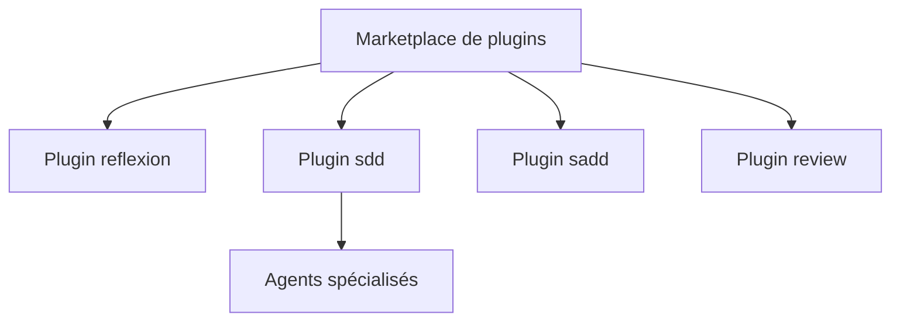

# NeoLabHQ/context-engineering-kit

> Collection of plugins and skills for coding agents, focused on the quality and reliability of results.

## The problem
A coding agent left to itself drifts on long tasks: forgotten requirements, hallucinations, saturated context.

## What it actually does
A plugin marketplace for Claude Code, also usable with Gemini CLI, Antigravity, Cursor, Codex and OpenCode. The commands cover reflection (`/reflect`, `/memorize`), multi-agent code review, sub-agents with a judge, specification-driven development (`/add-task`, `/plan-task`, `/implement-task`), TDD and Git. The reliability figures in the README come from the authors.

## How it is wired
Simplified diagram based on the card, no diagram provided.



## Trying it
```bash
/plugin marketplace add NeoLabHQ/context-engineering-kit
/plugin install reflexion@NeoLabHQ/context-engineering-kit
npx skills add NeoLabHQ/context-engineering-kit
```

## Cost and gotchas
The free plugins consume many tokens: the README announces an overhead of 1.5 to 35 times depending on the method. The reflection hook requires `bun`.

## What it is not
It is not a guarantee of correct code: the reliability percentages are internal estimates. Gemini CLI and Antigravity install all the plugins in one block.

## Alternatives
No alternative named in the README.

## For you
Worth watching: a good reservoir of patterns (judge, sub-agents, specifications) to draw from for your agents, provided you measure the token cost.
