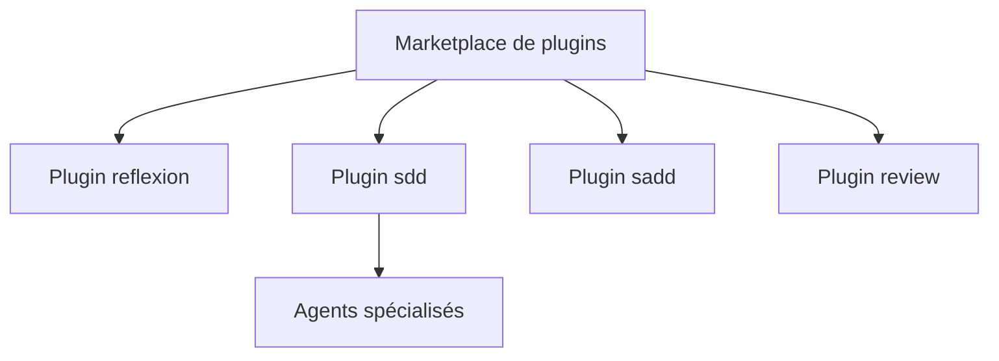

# NeoLabHQ/context-engineering-kit

> Collection de plugins et skills pour agents de code, centrée sur la qualité et la fiabilité des résultats.

## Le problème
Un agent de code livré à lui-même dérive sur les tâches longues : oublis d'exigences, hallucinations, contexte saturé.

## Ce que ça fait vraiment
Un marketplace de plugins pour Claude Code, utilisables aussi avec Gemini CLI, Antigravity, Cursor, Codex et OpenCode. Les commandes couvrent la réflexion (`/reflect`, `/memorize`), la revue de code multi-agents, les sous-agents avec juge, le développement piloté par spécification (`/add-task`, `/plan-task`, `/implement-task`), TDD et Git. Les chiffres de fiabilité du README viennent des auteurs.

## Comment c'est branché
Schéma simplifié d'après la fiche, sans diagramme fourni.



## Essayer
```bash
/plugin marketplace add NeoLabHQ/context-engineering-kit
/plugin install reflexion@NeoLabHQ/context-engineering-kit
npx skills add NeoLabHQ/context-engineering-kit
```

## Coût et pièges
Les plugins gratuits consomment beaucoup de jetons : le README annonce un surcoût de 1,5 à 35 fois selon la méthode. Le hook de réflexion demande `bun`.

## Ce que ce n'est pas
Ce n'est pas une garantie de code correct : les pourcentages de fiabilité sont des estimations internes. Gemini CLI et Antigravity installent tous les plugins d'un bloc.

## Alternatives
Aucune alternative nommée dans le README.

## Pour toi
À surveiller : un bon réservoir de patrons (juge, sous-agents, spécifications) à piocher pour tes agents, à condition de mesurer le coût en jetons.

