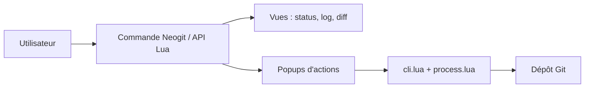

# NeogitOrg/neogit

> Magit-inspired Git interface for Neovim, for those who want to commit without leaving the editor.

## The problem
Juggling Git commands and a terminal breaks the flow inside Neovim.

## What it actually does
Opens a status view and popups for staging, commit, branches, stash, rebase, merge, push, pull, cherry-pick, bisect and worktrees. Offers log, diff, refs, reflog and commit views. Integrates with diffview or codediff, and with telescope, fzf-lua, mini.pick or snacks. Emits `Neogit*` events and a `PreBranchCheckout` hook.

## How it is wired


## Trying it
```lua
-- spec lazy.nvim
{ "NeogitOrg/neogit", cmd = "Neogit",
  keys = { { "<leader>gg", "<cmd>Neogit<cr>", desc = "Show Neogit UI" } } }
```
```vim
:Neogit
```

## Cost and gotchas
Free. Optional dependencies for diffs and pickers. State tracking can be expensive on a large repository: `auto_refresh` and `commit_order` are tunable.

## What it is not
Not a graphical Git client nor a complete Magit clone. Inline diffs only, except with diffview.

## Alternatives
No alternative named in the README (diffview.nvim is a dependency).

## For you
Adopt if Neovim is your editor: Git without leaving the editor, MIT, highly configurable.
