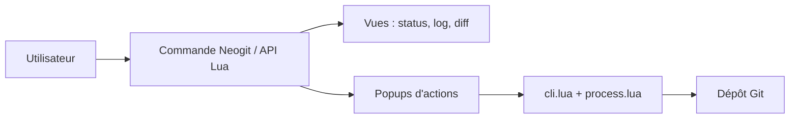

# NeogitOrg/neogit

> Interface Git pour Neovim inspirée de Magit, pour qui veut commiter sans quitter l'éditeur.

## Le problème
Enchaîner commandes Git et terminal coupe le flux dans Neovim.

## Ce que ça fait vraiment
Ouvre une vue d'état et des popups pour staging, commit, branches, stash, rebase, merge, push, pull, cherry-pick, bisect et worktrees. Offre des vues log, diff, refs, reflog et commit. S'intègre à diffview ou codediff, et à telescope, fzf-lua, mini.pick ou snacks. Émet des événements `Neogit*` et un hook `PreBranchCheckout`.

## Comment c'est branché


## Essayer
```lua
-- spec lazy.nvim
{ "NeogitOrg/neogit", cmd = "Neogit",
  keys = { { "<leader>gg", "<cmd>Neogit<cr>", desc = "Show Neogit UI" } } }
```
```vim
:Neogit
```

## Coût et pièges
Gratuit. Dépendances optionnelles pour diffs et pickers. Le suivi de l'état peut coûter cher sur un gros dépôt : `auto_refresh` et `commit_order` se règlent.

## Ce que ce n'est pas
Pas un client Git graphique ni un clone complet de Magit. Diffs inline seulement, sauf avec diffview.

## Alternatives
Aucune alternative nommée dans le README (diffview.nvim est une dépendance).

## Pour toi
À adopter si Neovim est ton éditeur : Git sans quitter l'éditeur, MIT, bien configurable.

