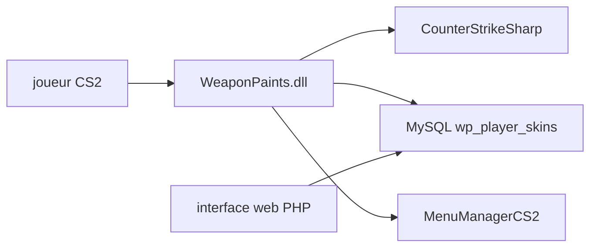

# Nereziel/cs2-WeaponPaints

> CounterStrikeSharp plugin for Counter-Strike 2 that enables custom weapon, knife, glove and agent skins.

## The problem
Players on a community CS2 server cannot choose or keep custom skins.

## What it actually does
Loads each player's choices from MySQL on connection and applies them: skins with wear, seed, StatTrak, stickers, knives, gloves, agents, music kits, pins. In-game menus (`!skins`, `!knife`...) and a small PHP web interface with Steam login. Tables are created automatically.

## How it is wired
Simplified diagram based on the sheet, no diagram provided.



## Trying it
```bash
git clone https://github.com/Nereziel/cs2-WeaponPaints.git
cd cs2-WeaponPaints
dotnet restore
dotnet build WeaponPaints.csproj -c Release
```

## Cost and gotchas
Requires a CS2 server, CounterStrikeSharp with runtime, three menu plugins and MySQL or MariaDB. `FollowCS2ServerGuidelines` must be set to `false`, which may violate Valve's rules. .NET 10 is required to build.

## What it is not
Not affiliated with Valve. No in-game editing of stickers or keychains. The web interface handles neither gloves, nor agents, nor music.

## Alternatives
No alternative named in the README.

## For you
Ignore: a game plugin unrelated to data or AI, with a compliance risk with respect to Valve.
