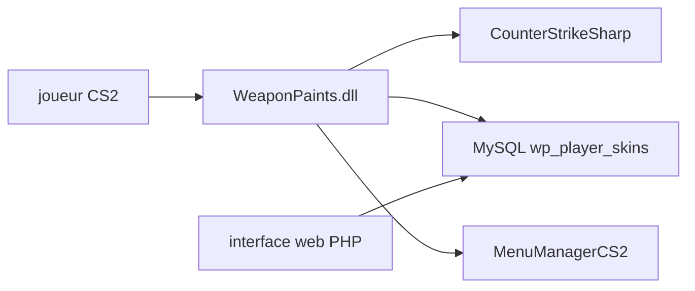

# Nereziel/cs2-WeaponPaints

> Plugin CounterStrikeSharp pour Counter-Strike 2 qui permet des skins d'armes, couteaux, gants et agents personnalisés.

## Le problème
Les joueurs d'un serveur communautaire CS2 ne peuvent pas choisir ni conserver des skins personnalisés.

## Ce que ça fait vraiment
Charge depuis MySQL les choix de chaque joueur à la connexion et les applique : skins avec usure, graine, StatTrak, autocollants, couteaux, gants, agents, kits musicaux, pins. Menus en jeu (`!skins`, `!knife`…) et petite interface web PHP avec connexion Steam. Les tables sont créées automatiquement.

## Comment c'est branché
Schéma simplifié d'après la fiche, sans diagramme fourni.



## Essayer
```bash
git clone https://github.com/Nereziel/cs2-WeaponPaints.git
cd cs2-WeaponPaints
dotnet restore
dotnet build WeaponPaints.csproj -c Release
```

## Coût et pièges
Demande un serveur CS2, CounterStrikeSharp avec runtime, trois plugins de menus et MySQL ou MariaDB. Il faut mettre `FollowCS2ServerGuidelines` à `false`, ce qui peut contrevenir aux règles de Valve. Le .NET 10 est requis pour compiler.

## Ce que ce n'est pas
Pas affilié à Valve. Pas d'édition en jeu des autocollants ni des porte-clés. L'interface web ne gère ni gants, ni agents, ni musique.

## Alternatives
Aucune alternative nommée dans le README.

## Pour toi
Ignorer : plugin de jeu sans rapport avec la data ou l'IA, avec un risque de conformité vis-à-vis de Valve.

