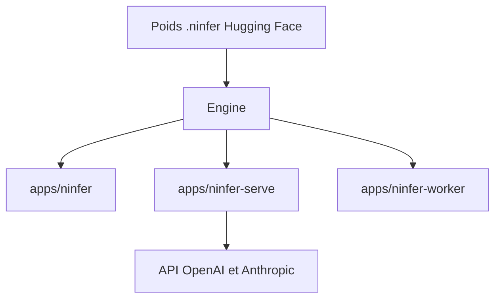

# Neroued/ninfer

> C++/CUDA inference engine for a few models on RTX 5090 and DGX Spark, with OpenAI-compatible APIs.

## The problem
Running a 27 to 35 billion parameter model locally at high throughput requires an engine tuned for your exact card.

## What it actually does
A CLI and an HTTP server (OpenAI and Anthropic APIs) for Qwen and GLM models converted to the `.ninfer` format. CUDA Graph decoding, MTP3 speculative decoding, shared prefix cache, up to eight active requests. Can run on two DGX Sparks. The throughputs and scores in the README are the author's own.

## How it is wired
Simplified diagram based on the sheet, no diagram provided.


## Trying it
```bash
cmake --preset rtx5090-release
cmake --build build/rtx5090-release -j
hf download neroued/Qwen3.8-27B-nvfp4-NInfer qwen3_8_27b_nvfp4.ninfer --local-dir models
```

## Cost and gotchas
Target hardware: RTX 5090 (sm_120a) or DGX Spark (sm_121a), CUDA 13.4, CMake 3.28+. The weights weigh from tens of GiB to 178 GiB depending on the model. Docker requires the NVIDIA Container Toolkit.

## What it is not
Not a general-purpose engine: selected models only. No installable C++ SDK. The measurements do not cover the current Spark or distributed paths.

## Alternatives
No alternative named in the README.

## For you
Worth watching: interesting if you own an RTX 5090 or a DGX Spark, unusable without that hardware, and carried by a single person.
