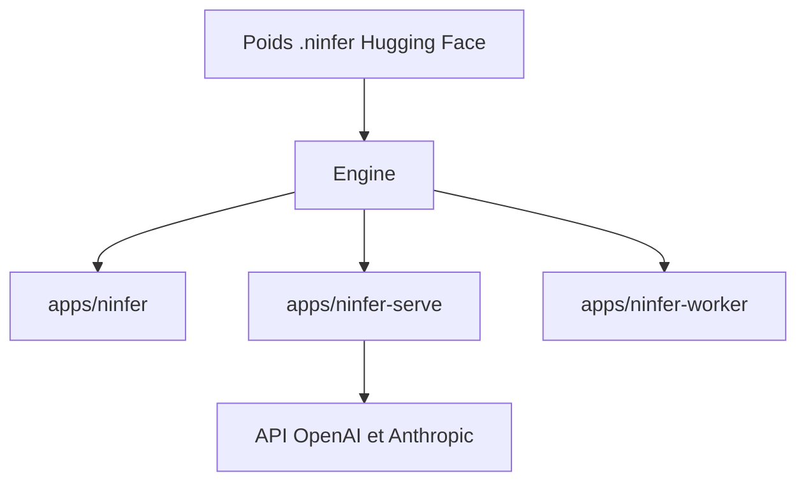

# Neroued/ninfer

> Moteur d'inférence C++/CUDA pour quelques modèles sur RTX 5090 et DGX Spark, avec API compatibles OpenAI.

## Le problème
Faire tourner un modèle de 27 à 35 milliards de paramètres en local avec un débit élevé demande un moteur réglé pour ta carte précise.

## Ce que ça fait vraiment
Une CLI et un serveur HTTP (API OpenAI et Anthropic) pour des modèles Qwen et GLM convertis au format `.ninfer`. Décodage avec CUDA Graph, décodage spéculatif MTP3, cache de préfixes partagés, jusqu'à huit requêtes actives. Exécution possible sur deux DGX Spark. Les débits et scores du README sont ceux de l'auteur.

## Comment c'est branché
Schéma simplifié d'après la fiche, sans diagramme fourni.


## Essayer
```bash
cmake --preset rtx5090-release
cmake --build build/rtx5090-release -j
hf download neroued/Qwen3.8-27B-nvfp4-NInfer qwen3_8_27b_nvfp4.ninfer --local-dir models
```

## Coût et pièges
Matériel ciblé : RTX 5090 (sm_120a) ou DGX Spark (sm_121a), CUDA 13.4, CMake 3.28+. Les poids pèsent de dizaines à 178 Gio selon le modèle. Docker demande le NVIDIA Container Toolkit.

## Ce que ce n'est pas
Pas un moteur généraliste : modèles sélectionnés seulement. Pas de SDK C++ installable. Les mesures ne couvrent pas les chemins Spark ou distribué actuels.

## Alternatives
Aucune alternative nommée dans le README.

## Pour toi
À surveiller : intéressant si tu possèdes une RTX 5090 ou un DGX Spark, inutilisable sans ce matériel, et porté par une seule personne.

