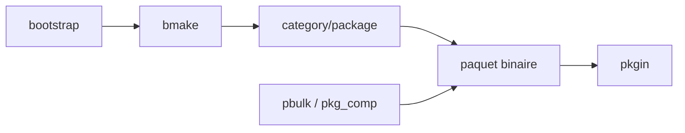

# NetBSD/pkgsrc

> A software package build framework for UNIX systems, the default package manager of NetBSD and SmartOS.

## The problem
Compiling and installing software consistently across varied UNIX systems, without depending on each OS's package manager.

## What it actually does
Produces binary packages manageable with pkgin. Configurable install prefix (default `/usr/pkg`), several branches side by side, a framework for build options and compiler transformation. Unprivileged use is possible. The sources live in a CVS; GitHub is only a mirror updated every few hours.

## How it is wired


## Trying it
```bash
cd pkgsrc/bootstrap
./bootstrap
cd pkgsrc/category/package-name
$PREFIX/bin/bmake install
```

## Cost and gotchas
Free, but the bootstrap has no connection to a data/AI workflow. Per-OS details are in `bootstrap/README.OS`, not provided here.

## What it is not
Not a watch tool nor a data science tool: it is system infrastructure. The GitHub repository is a mirror of the CVS, not the reference source.

## Alternatives
No alternative named in the README (pkgin is the tool for managing the produced binaries).

## For you
Ignore: only useful if you administer NetBSD/SmartOS, outside the data/AI/MLOps scope.
