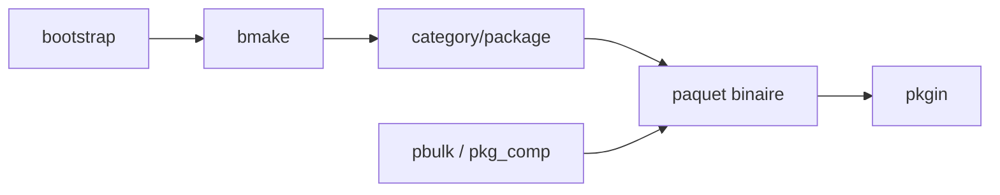

# NetBSD/pkgsrc

> Framework de construction de paquets logiciels pour systèmes UNIX, gestionnaire par défaut de NetBSD et SmartOS.

## Le problème
Compiler et installer des logiciels de façon cohérente sur des UNIX variés, sans dépendre du gestionnaire de paquets de chaque OS.

## Ce que ça fait vraiment
Produit des paquets binaires gérables avec pkgin. Préfixe d'installation configurable (défaut `/usr/pkg`), plusieurs branches côte à côte, framework d'options de build et de transformation du compilateur. Usage sans privilèges possible. Les sources vivent dans un CVS ; GitHub n'en est qu'un miroir mis à jour toutes les quelques heures.

## Comment c'est branché


## Essayer
```bash
cd pkgsrc/bootstrap
./bootstrap
cd pkgsrc/category/package-name
$PREFIX/bin/bmake install
```

## Coût et pièges
Gratuit, mais le bootstrap est sans lien avec un flux data/IA. Les détails par OS sont dans `bootstrap/README.OS`, non fourni ici.

## Ce que ce n'est pas
Pas un outil de veille ni de data science : c'est de l'infrastructure système. Le dépôt GitHub est un miroir du CVS, pas la source de référence.

## Alternatives
Aucune alternative nommée dans le README (pkgin est l'outil de gestion des binaires produits).

## Pour toi
À ignorer : utile seulement si tu administres des NetBSD/SmartOS, hors périmètre data/IA/MLOps.

