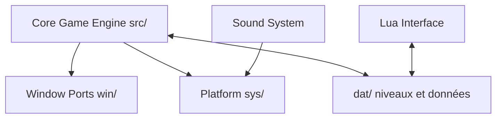

# NetHack/NetHack

> Source code of the dungeon-exploration game NetHack, version 5.0.1 in progress, for players and porters.

## The problem
A classic roguelike has to run on many old and recent systems, which demands portable code.

## What it actually does
It is the game itself, derived from NetHack 3.6. Version 5.0 follows the C99 standard, allows cross-compilation and replaces the yacc/lex compilers for levels and dungeons with Lua files read during play. The README lists the tested platforms: Linux, Windows, macOS, MS-DOS, AmigaOS, OpenVMS.

## How it is wired


## Trying it
```bash
# Aucune commande de build dans ce README : suivre les fichiers
# sys/*/Install.* ou sys/unix/NewInstall.unx cités dans le texte.
```

## Cost and gotchas
Free. The catalog finds no license; the README refers to a "license" file in `dat` to be read before anything else. The 5.0.1 branch is not a published release: the text recommends 5.0.0 for stability.

## What it is not
Not a product ready to install from a package: you have to compile it. The project gives neither gameplay tips nor a release schedule.

## Alternatives
No alternative named in the README.

## For you
Ignore: it is a game, unrelated to data, AI or MLOps work.
