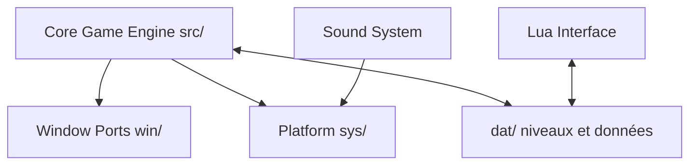

# NetHack/NetHack

> Code source du jeu d'exploration de donjons NetHack, version 5.0.1 en cours, pour joueurs et porteurs.

## Le problème
Un roguelike classique doit tourner sur de nombreux systèmes anciens et récents, ce qui demande un code portable.

## Ce que ça fait vraiment
C'est le jeu lui-même, dérivé de NetHack 3.6. La version 5.0 suit le standard C99, permet la compilation croisée et remplace les compilateurs yacc/lex de niveaux et de donjons par des fichiers Lua lus pendant la partie. Le README liste les plateformes testées : Linux, Windows, macOS, MS-DOS, AmigaOS, OpenVMS.

## Comment c'est branché


## Essayer
```bash
# Aucune commande de build dans ce README : suivre les fichiers
# sys/*/Install.* ou sys/unix/NewInstall.unx cités dans le texte.
```

## Coût et pièges
Gratuit. Le catalogue ne trouve aucune licence ; le README renvoie à un fichier « license » dans `dat` à lire avant tout. La branche 5.0.1 n'est pas une version publiée : le texte conseille la 5.0.0 pour la stabilité.

## Ce que ce n'est pas
Pas un produit prêt à installer par un paquet : il faut compiler. Le projet ne donne ni astuces de jeu ni calendrier de version.

## Alternatives
Aucune alternative nommée dans le README.

## Pour toi
À ignorer : c'est un jeu, sans rapport avec un travail data, IA ou MLOps.

