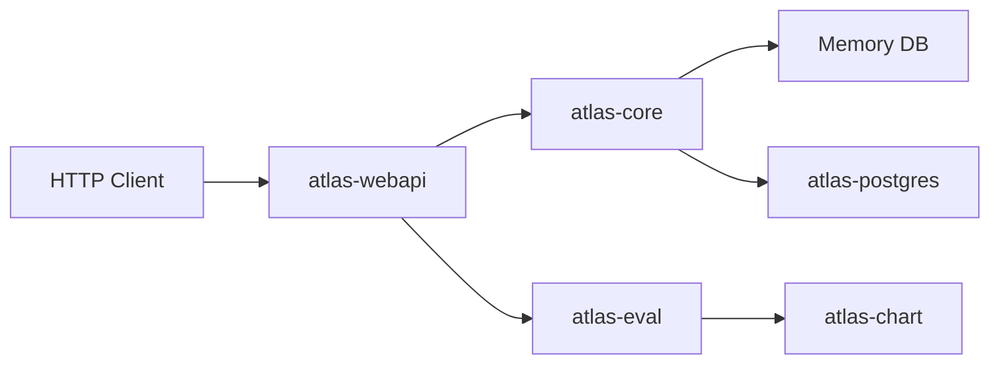

# Netflix/atlas

> Scala backend for managing dimensional time series, for observability teams.

## The problem
Storing and querying large volumes of dimensional metrics requires a dedicated engine.

## What it actually does
Near-empty README (links only). Based on the architecture: multi-module project with a core (model, queries, algorithms, index), web APIs (graphs, expressions, tags, publishing), streaming evaluation, chart rendering and PostgreSQL support.

## How it is wired


## Trying it
```bash
# non documenté dans le README
```

## Cost and gotchas
Not documented: see the external documentation. Installation and operation are not described here.

## What it is not
Not a tool documented in its README: impossible to assess how easy it is to get started without the external docs.

## Alternatives
- None cited in the README.

## For you
Worth watching for lack of material: the repository touches on telemetry, but I cannot conclude anything else without the documentation.
