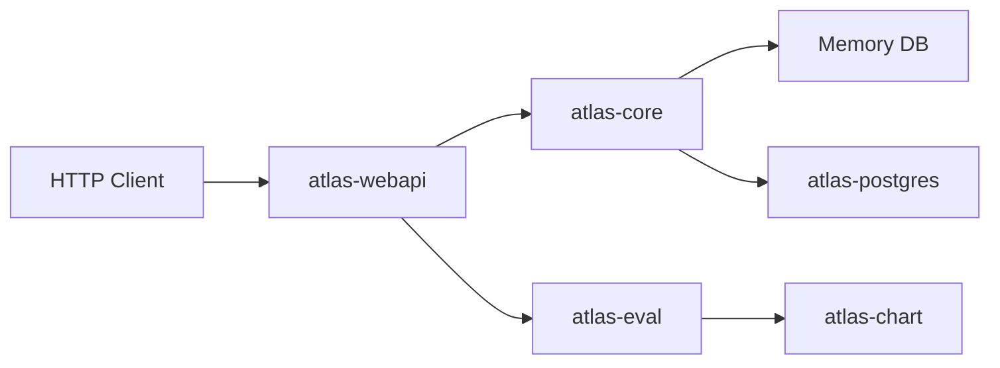

# Netflix/atlas

> Backend Scala de gestion de séries temporelles dimensionnelles, pour équipes d'observabilité.

## Le problème
Stocker et interroger de grands volumes de métriques à dimensions demande un moteur dédié.

## Ce que ça fait vraiment
README quasi vide (liens seulement). D'après l'architecture : projet multi-modules avec un cœur (modèle, requêtes, algorithmes, index), des API web (graphes, expressions, tags, publication), évaluation en flux, rendu de graphiques et support PostgreSQL.

## Comment c'est branché


## Essayer
```bash
# non documenté dans le README
```

## Coût et pièges
Non documenté : voir la documentation externe. Installation et exploitation non décrites ici.

## Ce que ce n'est pas
Pas un outil documenté dans son README : impossible d'évaluer la prise en main sans la doc externe.

## Alternatives
- Aucune citée dans le README.

## Pour toi
À surveiller faute de matière : le dépôt touche à la télémétrie, mais je ne peux rien trancher d'autre sans la documentation.

