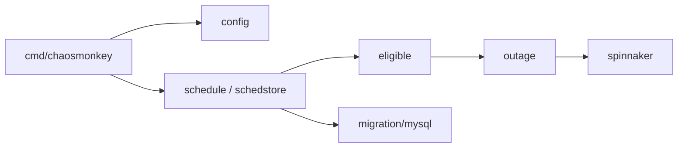

# Netflix/chaosmonkey

> Netflix tool that randomly shuts down production instances, for teams managed with Spinnaker.

## The problem
You discover a service's fragility on the day it fails. Without regular, deliberately caused failures, nobody builds services that hold up.

## What it actually does
Chaos Monkey randomly terminates production virtual machines or containers. It must go through Spinnaker: without Spinnaker-managed applications, it cannot terminate anything. Tested with AWS, GCE and Kubernetes. The code describes a scheduler (`schedule`, `schedstore`), eligibility rules (`eligible`), a termination module (`outage`) and MySQL storage (`migration`).

## How it is wired


## Trying it
```bash
go get github.com/netflix/chaosmonkey/cmd/chaosmonkey
```
Deployment and configuration are deferred to external documentation: not documented in the README.

## Cost and gotchas
You need Spinnaker already in place and a MySQL database for scheduling. The last push dates from January 2025: more than a year without updates.

## What it is not
It is not a standalone tool: without Spinnaker, it does nothing. It is not a testbed for a local workstation nor a fine-grained fault injection tool (latency, network): it only shuts down instances.

## Alternatives
No alternative named in the README (only the Principles of Chaos Engineering are cited).

## For you
Keep an eye on it: useful for understanding chaos practice in production, but unusable without Spinnaker and without a recent update, so of little relevance for a data/MLOps profile that does not have this platform.
